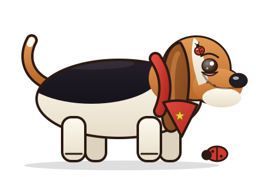

# Neo Boing Platinum OS

**English** · [Srpski](README.sr.md)

Neo Boing Platinum OS (NBPOS) is an operating system with a human face: one system that is the same for a child, an adult and a professional. It is meant to be the only computer in the house, covering mail, web, office, photos, music, learning, games and retro, with no account and no telemetry.

**Dijana**, the resident who lives on the desktop, is the system's logo for now. She appears on the demo pages and in the videos. Her art is in [assets/dijana/](assets/dijana/).

**The system stands on its own.** Its first release, **Neo Boing Platinum OS Lite**, is built for ordinary computers that exist today: generic **x86_64 PCs** and **ARM boards**. No special hardware is needed. A separate *concept computer* (concept hardware) is described briefly at the end of this page as an optional idea for the future; it is not needed to build, run or use the system.

> **Status: the code is here and open for contributions.** The *Fortress* kernel boots on x86_64 and AArch64 under QEMU and from a bootable ISO (BIOS and UEFI). It runs Rust programs in user mode with capabilities and message ports, and has a keyboard (US and Serbian Latin), a mouse (PS/2 and USB), a screen with windows, a disk, a terminal and the Neo DOS command line. The first Neo program also runs on Genode and seL4 (see [genode/](genode/README.md)). [docs/STATUS.md](docs/STATUS.md) tracks what is done and planned; [docs/FEATURES.md](docs/FEATURES.md) lists every feature by scope; [docs/PROGRESS.md](docs/PROGRESS.md) is the step-by-step log.

> **About the name.** Until 18 November 2026 the system was called *NeoOS* (or *Neo OS*). Other, unrelated projects use that name, so it is now **Neo Boing Platinum OS**. *Boing* here is a nod to the Amiga spirit; the project does not use the Amiga Boing Ball logo, which is a trademark of its owner. Some program names inside the code still show the old name. The videos were updated to the new name on 27 November 2026 (see [docs/VIDEOS.md](docs/VIDEOS.md)).

## User guide and help

| | English | Srpski |
| --- | --- | --- |
| **User guide (start here)**: every plan and feature page as a web page | [guide/html-en/index.html](guide/html-en/index.html) | [guide/html-sr/index.html](guide/html-sr/index.html) |
| The same guide as one PDF | [NBPOS-guide-en.pdf](guide/NBPOS-guide-en.pdf) | [NBPOS-vodic-sr.pdf](guide/NBPOS-vodic-sr.pdf) |
| Beta manual of the desktop (work in progress) | [neo-manual-beta.html](docs/html/en/neo-manual-beta.html) | [neo-prirucnik-beta.html](docs/html/sr/neo-prirucnik-beta.html) |
| How help will work inside the system (F1, pictures of the real screen, offline) | [docs/HELP.md](docs/HELP.md) | [docs/HELP.sr.md](docs/HELP.sr.md) |
| Building the bootable image and the first boot on a PC | [docs/BUILD-ISO.md](docs/BUILD-ISO.md) | [docs/BUILD-ISO.sr.md](docs/BUILD-ISO.sr.md) |
| Trying it on a real PC and reporting what happened | [docs/REAL-PC-TEST.md](docs/REAL-PC-TEST.md) | [docs/REAL-PC-TEST.sr.md](docs/REAL-PC-TEST.sr.md) |

GitHub shows HTML as source. Download the repository as a ZIP (or the `guide/` folder) and open `index.html` in a browser; it needs no server and no network. `python3 scripts/build-guide.py` rebuilds the guide (HTML and PDF) from the Markdown files in `docs/`.

## Neo Boing Platinum OS Lite: what it runs on

Lite is the part that is built and tested now. It takes in everything from the earlier full and Pro design that software can do on today's hardware, including the games, the creative and music apps, Cabinet Pro, Crunch, the Tiles and the help system.

- **Generic x86_64 PCs**: first development target, with an AMD Zen 2 (Ryzen 3000) PC as the reference and Intel Core 10th generation as its equivalent. It runs under QEMU and from a USB stick or CD (hybrid ISO, BIOS and UEFI).
- **Generic ARM (AArch64)**: QEMU `virt` now, then the **Raspberry Pi 5** (main ARM board; the Pi 4 as well).
- **Neo Revive**: the system from a USB stick on old 64-bit UEFI PCs (roughly 2012 on, 2 GB RAM or more).
- **Phones**: experimental, only where open drivers exist.

Programs that already exist for Linux (games, Kdenlive, GIMP, gThumb, qBittorrent, Hydrogen and more) run in the **Linux box** through Flatpak, under Neo names and with Neo's privacy rules, until native versions exist. See [docs/FEATURES.md](docs/FEATURES.md), [docs/GAMES.md](docs/GAMES.md), [docs/CREATIVE-APPS.md](docs/CREATIVE-APPS.md) and [docs/MUSIC.md](docs/MUSIC.md).

### What to expect on today's hardware (estimate)

Targets for the planned Lite 1.0 desktop, not measurements yet; the full table and notes are in [docs/FEATURES.md](docs/FEATURES.md#4-performance-on-todays-hardware-estimate).

| | **Raspberry Pi 5**, 8 GB (minimum) | **Intel Core 10th gen** (e.g. i5-10400), 16 GB | **AMD Zen 2** (e.g. Ryzen 5 3600 with a graphics card), 16 GB (reference) |
| --- | --- | --- | --- |
| Start to desk | about 10–15 s from an SSD | about 5–8 s | about 5–8 s |
| Smooth desk at 60 Hz | 1080p, all effects | 1440p, all effects | 4K, all effects |
| Windows open before anything slows | about 15–20 | about 40 | 50 or more |
| Linux box programs | office, web, GIMP; Kdenlive 1080p with proxy files | all; Kdenlive 4K with proxy files | all; Kdenlive 4K |
| Games and Arcade | 2D games, SuperTuxKart on low; emulators up to PlayStation 1 | 3D games on medium; up to Nintendo 64 and Dreamcast | 3D games on high; up to PlayStation 2 and GameCube |

**Open Translation [lite].** Right-click any document, web page or selected text and choose *Translate to…* to get it in a major world language. It uses **LibreTranslate** with Argos Translate models, running on your own computer and offline once the language packs are in; nothing is sent to Google Translate or any other cloud service. See [docs/FEATURES.md](docs/FEATURES.md).

## System demos

Browser simulations of features of the system itself. They are made to show how the system will feel; they are not the system. Download the folder and open the file in a browser.

| | English | Srpski |
| --- | --- | --- |
| All demos (start here) | [neo-demos.html](docs/html/en/demo/neo-demos.html) | [neo-demoi.html](docs/html/sr/demo/neo-demoi.html) |
| The Neo desk | [neo-demo.html](docs/html/en/demo/neo-demo.html) | [neo-demo.html](docs/html/sr/demo/neo-demo.html) |
| Cabinet Pro and Duo (file manager) | [neo-cabinet.html](docs/html/en/demo/neo-cabinet.html) | [neo-ormar.html](docs/html/sr/demo/neo-ormar.html) |
| Cabinet Pro: Magellan (rules and automation) | [neo-cabinet-magellan.html](docs/html/en/demo/neo-cabinet-magellan.html) | [neo-ormar-magellan.html](docs/html/sr/demo/neo-ormar-magellan.html) |
| Neo DOS (command line) | [neo-dos.html](docs/html/en/demo/neo-dos.html) | [neo-dos.html](docs/html/sr/demo/neo-dos.html) |
| Tiles and the Bar | [neo-tiles.html](docs/html/en/demo/neo-tiles.html) | [neo-ploce.html](docs/html/sr/demo/neo-ploce.html) |
| Crunch (compression and archives) | [neo-crunch.html](docs/html/en/demo/neo-crunch.html) | [neo-zgusni.html](docs/html/sr/demo/neo-zgusni.html) |
| First Desk (the retro theme) | [neo-first-desk.html](docs/html/en/demo/neo-first-desk.html) | [neo-prvi-sto.html](docs/html/sr/demo/neo-prvi-sto.html) |
| School, languages, news, phone link, and Claude help (distant future, not guaranteed) | [docs/html/en/demo](docs/html/en/demo) | [docs/html/sr/demo](docs/html/sr/demo) |
| Dijana, the resident (pixel and vector art) | [assets/dijana/](assets/dijana/) | [assets/dijana/](assets/dijana/) |

## System videos

Two short videos of the system itself, and both use real screenshots from QEMU. The first shows BIOS and UEFI boot, the first window, Neo DOS, keyboard layouts and what is planned for Lite. The second shows what is new: Dijana on the Bar, her tip after an error and her good night at shutdown, the Meter tile, and the work under the hood (no flicker, USB behind hubs, USB and PCI in Neo DOS). No concept hardware appears in either.

| | English | Srpski |
| --- | --- | --- |
| Neo Boing Platinum OS: the system (1:16, 720p) | [NBPOS-system-en.mp4](docs/video/en/NBPOS-system-en.mp4) | [NBPOS-sistem-sr.mp4](docs/video/sr/NBPOS-sistem-sr.mp4) |
| What's new in the system (0:46, 720p) | [NBPOS-whats-new-en.mp4](docs/video/en/NBPOS-whats-new-en.mp4) | [NBPOS-sta-je-novo-sr.mp4](docs/video/sr/NBPOS-sta-je-novo-sr.mp4) |

The concept computer has its own video, in the concept section at the end of this page. [docs/VIDEOS.md](docs/VIDEOS.md) lists every video and says which side each one belongs to.

## System documents

| Document | English | Srpski |
| --- | --- | --- |
| Neo Boing Platinum OS 1.0: specification and development plan (its hardware chapters are concept hardware) | [PDF](docs/pdf/en/Neo-Boing-Platinum-OS-1.0-specification.pdf) · [web](docs/html/en/neoos-1-0-specification.html) | [PDF](docs/pdf/sr/Neo-Boing-Platinum-OS-1.0-specifikacija.pdf) · [web](docs/html/sr/neoos-1-0.html) |
| What else Neo can do | [PDF](docs/pdf/en/Neo-what-else-it-can-do.pdf) | [PDF](docs/pdf/sr/Neo-sta-jos-ume.pdf) |
| Fed up? (what the system removes from everyday computing) | [PDF](docs/pdf/en/Neo-fed-up.pdf) | [PDF](docs/pdf/sr/Neo-dosadilo-vam-je.pdf) |

The specification is a working draft. Every figure in it is an engineering estimate, not a measurement.

## Architecture in one table

| Layer | What it is |
| --- | --- |
| Apps and games | File manager, browser, office, Arcade (MAME, DOSBox, ScummVM, RetroArch), programs from the Treasury catalogue, Linux programs in the Linux box |
| Neo Kit and Lux | One windowing toolkit, themes, Datatypes, a scripting port in every app |
| System services | Exec-N (message ports), Dispatcher, Chronos (snapshots), Renewal (A/B updates), Lock (privacy), Keeper (backups), Find |
| Drivers | Native drivers in Rust; Linux driver code only inside isolated components |
| Fortress | seL4-class microkernel that hands out memory, CPU time and capabilities |
| Boot and Safe | Boot loader (GRUB or UEFI today), signed A/B system image, keys |

Design rules: responsiveness before throughput; one system, one API, one look; every app scriptable; small and understandable, with a size and memory budget for every system app. The system is written in Rust.

The desktop look, *Neo Silver*, follows classic Mac OS with the best of BeOS, Haiku, MorphOS and the Amiga. Every name, icon and drawing is the project's own. Serbian (Latin and Cyrillic) and English (UK and US) are the first languages, and a localisation kit makes adding any other language easy.

## Plans and feature lists

| Page | What it covers |
| --- | --- |
| [docs/FEATURES.md](docs/FEATURES.md) | Everything the system does or plans, tagged [done], [next], [lite] or [concept] |
| [docs/STATUS.md](docs/STATUS.md) | Milestones and progress |
| [docs/GAMES.md](docs/GAMES.md) | Games in Lite: own games, Arcade (MAME, DOSBox, ScummVM, RetroArch) and open-source games through Flatpak |
| [docs/CREATIVE-APPS.md](docs/CREATIVE-APPS.md) | FilmCraft (Kdenlive), PhotoCraft (GIMP and Inkscape), Album (gThumb) |
| [docs/MUSIC.md](docs/MUSIC.md) | HippoPlayer, qBittorrent, Hydrogen, a beatmaker, tracker exchange |
| [docs/APP-NAMES.md](docs/APP-NAMES.md) | Simple app names and what each program is based on |
| [docs/KIDS.md](docs/KIDS.md) | Neo Boing Platinum OS Lite for children |
| [docs/RAD.md](docs/RAD.md) | RAD: in the base version |
| [docs/AMIGA.md](docs/AMIGA.md), [docs/CLASSIC-MAC.md](docs/CLASSIC-MAC.md), [docs/BEOS-HAIKU.md](docs/BEOS-HAIKU.md), [docs/RISC-OS.md](docs/RISC-OS.md), [docs/SYSTEM7-REFERENCE.md](docs/SYSTEM7-REFERENCE.md) | Ideas and software taken from other systems |
| [docs/RESIDENTS.md](docs/RESIDENTS.md), [docs/MASCOT.md](docs/MASCOT.md) | Residents: Dijana, and the Snake as a second one |
| [docs/HANDOFF.md](docs/HANDOFF.md), [docs/SCHEDULED-CODING.md](docs/SCHEDULED-CODING.md) | How to continue coding, and coding on a schedule on your own PC |

## Built on open source

Anything that already exists as a mature open project is used as the foundation; only what is new is written from scratch, and changes go back upstream. Candidates include Genode on seL4, Linux driver code in isolated components, Btrfs and EROFS, Mesa, Smithay, the Haiku Interface Kit, PipeWire, Flatpak, QEMU, LLVM and Rust.

## How to help

Start with [CONTRIBUTING.md](CONTRIBUTING.md): what you need, how to build and run the boot tests, and the rules a change must keep. [docs/STARTER-TASKS.md](docs/STARTER-TASKS.md) lists twelve starter tasks, each with its test, and each is also an issue. Questions, ideas and comments on the specification are welcome as issues too.

---

## Separately: the ideal computer concept (concept hardware)

> **Concept hardware. Not available, not needed.** Everything in this section is a vision of a future computer. None of it exists, and the system above does not depend on it.

In short: the **Neo 500, 2000 and 4000** and the **NeoPocket** handheld (concept hardware) are an idea of dedicated computers that would ship with Neo Boing Platinum OS, built around a fast ARM processor, an FPGA and the Neo chips. On them the preinstalled system would be **one feature among many**, not a requirement; the same system runs on any PC or ARM board. Claude integration is a separate distant-future idea, not guaranteed. See [docs/CONCEPT-COMPUTER.md](docs/CONCEPT-COMPUTER.md) for the rule that keeps the two apart.

| Concept document (concept hardware) | English | Srpski |
| --- | --- | --- |
| The Neo family of computers (overview) | [PDF](docs/pdf/en/Neo-overview.pdf) · [web](docs/html/en/neo-overview.html) | [PDF](docs/pdf/sr/Neo-pregled.pdf) · [web](docs/html/sr/neo-porodica.html) |
| Promo brochure | [PDF](docs/pdf/en/Neo-promo-brochure.pdf) · [web](docs/html/en/neo-promo-brochure.html) | [PDF](docs/pdf/sr/Neo-promo-brosura.pdf) · [web](docs/html/sr/neo-brosura.html) |
| Neo inside (technical book; the Crystal theme with DJ Nick is a concept, a possibility, not an agreement) | [PDF](docs/pdf/en/Neo-technical-book.pdf) · [web](docs/html/en/neo-technical-book.html) | [PDF](docs/pdf/sr/Neo-tehnicka-knjiga.pdf) · [web](docs/html/sr/neo-tehnicka-knjiga.html) |
| Neo identity | [web](docs/html/en/neo-identity.html) | [web](docs/html/sr/neo-identitet.html) |
| Video: the concept computer (0:55, 720p) | [video](docs/video/en/Neo-concept-computer-en.mp4) | [video](docs/video/sr/Neo-konceptni-racunar-sr.mp4) |
| Neo for everyone (device sizes from a handheld to the Neo 4000) | [demo](docs/html/en/demo/neo-for-everyone.html) | [demo](docs/html/sr/demo/neo-za-svakog.html) |

These documents were written before the system and the concept were separated, so they mix both. They will be split file by file in a later change; until then, whatever in them needs Neo hardware is concept hardware.

## Licence

Neo Boing Platinum OS is free software under the GNU General Public License, version 3 or (at your option) any later version. See [LICENSE](LICENSE).
