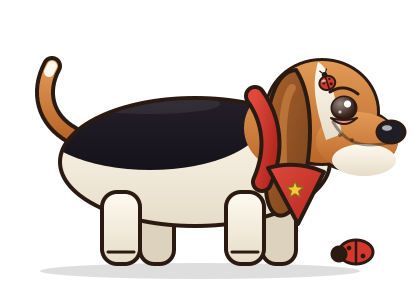

# Neo Boing Platinum OS

[English](README.md) · **Srpski**

Neo Boing Platinum OS (NBPOS) je operativni sistem sa ljudskim licem: jedan sistem, isti za dete, odraslog i profesionalca. Treba da bude jedini računar u kući: pošta, veb, kancelarija, fotografije, muzika, učenje, igre i retro, bez naloga i bez telemetrije.

**Dijana**, stanar koji živi na radnoj površini, za sada je logo sistema. Pojavljuje se na stranama demoa i u video snimcima. Njeni crteži su u [assets/dijana/](assets/dijana/).

**Sistem stoji sam za sebe.** Njegovo prvo izdanje, **Neo Boing Platinum OS Lite**, pravi se za obične računare koji postoje danas: opšte **x86_64 PC računare** i **ARM ploče**. Nikakav poseban hardver nije potreban. Odvojeni *konceptni računar* (konceptni hardver) ukratko je opisan na kraju ove strane kao opciona ideja za budućnost; nije potreban da bi se sistem gradio, pokretao ili koristio.

> **Stanje: kod je ovde i otvoren za doprinose.** Jezgro *Tvrđava* (Fortress) podiže se na x86_64 i AArch64 u QEMU-u i sa pokretačkog ISO-a (BIOS i UEFI). Pokreće programe pisane u Rustu u korisničkom režimu, sa ovlašćenjima (capabilities) i portovima za poruke, i ima tastaturu (US i srpska latinica), miša (PS/2 i USB), ekran sa prozorima, disk, terminal i Neo DOS komandnu liniju. Prvi Neo program radi i na Genode-u sa seL4 (vidi [genode/](genode/README.sr.md)). U [docs/STATUS.sr.md](docs/STATUS.sr.md) se prati šta je urađeno i planirano; [docs/FEATURES.sr.md](docs/FEATURES.sr.md) navodi sve mogućnosti po obimu; [docs/PROGRESS.md](docs/PROGRESS.md) je dnevnik razvoja korak po korak (na engleskom).

> **O imenu.** Do 18. novembra 2026. sistem se zvao *NeoOS* (ili *Neo OS*). To ime koriste i drugi, nepovezani projekti, pa se sada zove **Neo Boing Platinum OS**. *Boing* je ovde pozdrav duhu Amige; projekat ne koristi logo Amiga Boing Ball, koji je zaštitni znak svog vlasnika. Neka imena programa u kodu još pokazuju staro ime. Video snimci su prepravljeni na novo ime 27. novembra 2026. (vidi [docs/VIDEOS.sr.md](docs/VIDEOS.sr.md)).

## Korisničko uputstvo i pomoć

| | Srpski | English |
| --- | --- | --- |
| **Korisnički vodič (počni ovde)**: sve strane planova i mogućnosti kao veb stranice | [guide/html-sr/index.html](guide/html-sr/index.html) | [guide/html-en/index.html](guide/html-en/index.html) |
| Isti vodič kao jedan PDF | [NBPOS-vodic-sr.pdf](guide/NBPOS-vodic-sr.pdf) | [NBPOS-guide-en.pdf](guide/NBPOS-guide-en.pdf) |
| Beta priručnik radne površine (u izradi) | [neo-prirucnik-beta.html](docs/html/sr/neo-prirucnik-beta.html) | [neo-manual-beta.html](docs/html/en/neo-manual-beta.html) |
| Za ljubitelje AmigaOS-a, klasičnog Mac OS-a, RISC OS-a, BeOS-a i Haiku-a: šta sistem pozajmljuje od svakog (stranica, PDF od 2 strane, video 0:58) | [neo-klasici.html](docs/html/sr/neo-klasici.html) · [PDF](guide/NBPOS-klasici-sr.pdf) · [video](docs/video/sr/NBPOS-klasici-sr.mp4) | [neo-classics.html](docs/html/en/neo-classics.html) · [PDF](guide/NBPOS-classics-en.pdf) · [video](docs/video/en/NBPOS-classics-en.mp4) |
| Piši, pošalji, pričaj: Pero u tri režima, Pismo (pošta) i Razgovor (čet bez naloga), plan sa demoom i videom 0:47 | [strana](docs/WRITE-SEND-TALK.sr.md) · [demo](docs/html/sr/demo/neo-pisi-posalji-pricaj.html) · [video](docs/video/sr/NBPOS-pisi-posalji-pricaj-sr.mp4) | [page](docs/WRITE-SEND-TALK.md) · [demo](docs/html/en/demo/neo-write-send-talk.html) · [video](docs/video/en/NBPOS-write-send-talk-en.mp4) |
| Kako će pomoć raditi u sistemu (F1, slike pravog ekrana, bez mreže) | [docs/HELP.sr.md](docs/HELP.sr.md) | [docs/HELP.md](docs/HELP.md) |
| Pravljenje pokretačke slike i prvo paljenje na PC-ju | [docs/BUILD-ISO.sr.md](docs/BUILD-ISO.sr.md) | [docs/BUILD-ISO.md](docs/BUILD-ISO.md) |
| Proba na pravom računaru i izveštaj o tome šta se desilo | [docs/REAL-PC-TEST.sr.md](docs/REAL-PC-TEST.sr.md) | [docs/REAL-PC-TEST.md](docs/REAL-PC-TEST.md) |

GitHub prikazuje HTML kao izvorni kod. Preuzmi repozitorijum kao ZIP (ili samo fasciklu `guide/`) i otvori `index.html` u pregledaču; ne trebaju ni server ni mreža. `python3 scripts/build-guide.py` ponovo gradi vodič (HTML i PDF) iz Markdown fajlova u `docs/`.

## Neo Boing Platinum OS Lite: na čemu radi

Lite je deo koji se gradi i testira sada. Preuzima sve iz ranije pune i Pro verzije što softver može na današnjem hardveru, uključujući igre, kreativne i muzičke programe, Ormar Pro, Zgusni, Pločice i sistem pomoći.

- **Opšti x86_64 PC**: prvi razvojni cilj, sa PC-jem na AMD Zen 2 (Ryzen 3000) kao referencom i Intel Core 10. generacije kao ekvivalentom. Radi u QEMU-u i sa USB-a ili CD-a (hibridni ISO, BIOS i UEFI).
- **Opšti ARM (AArch64)**: sada QEMU `virt`, zatim **Raspberry Pi 5** (glavna ARM ploča; i Pi 4).
- **Neo Revive**: sistem sa USB-a na starim 64-bitnim UEFI računarima (otprilike od 2012, 2 GB RAM-a ili više).
- **Telefoni**: eksperimentalno, samo gde postoje otvoreni drajveri.

Programi koji već postoje za Linux (igre, Kdenlive, GIMP, gThumb, qBittorrent, Hydrogen i drugi) rade u **Linux kutiji** preko Flatpaka, pod Neo imenima i sa Neo pravilima privatnosti, dok ne nastanu izvorne verzije. Vidi [docs/FEATURES.sr.md](docs/FEATURES.sr.md), [docs/GAMES.sr.md](docs/GAMES.sr.md), [docs/CREATIVE-APPS.sr.md](docs/CREATIVE-APPS.sr.md) i [docs/MUSIC.sr.md](docs/MUSIC.sr.md).

### Šta očekivati na današnjem hardveru (procena)

Ciljevi za planiranu radnu površinu Lite 1.0, još ne merenja; cela tabela i napomene su u [docs/FEATURES.sr.md](docs/FEATURES.sr.md#4-performanse-na-današnjem-hardveru-procena).

| | **Raspberry Pi 5**, 8 GB (minimum) | **Intel Core 10. gen.** (npr. i5-10400), 16 GB | **AMD Zen 2** (npr. Ryzen 5 3600 sa grafičkom karticom), 16 GB (referenca) |
| --- | --- | --- | --- |
| Od paljenja do stola | oko 10–15 s sa SSD-a | oko 5–8 s | oko 5–8 s |
| Glatka radna površina na 60 Hz | 1080p, svi efekti | 1440p, svi efekti | 4K, svi efekti |
| Otvorenih prozora pre nego što išta uspori | oko 15–20 | oko 40 | 50 i više |
| Programi iz Linux kutije | kancelarija, veb, GIMP; Kdenlive 1080p uz proxy fajlove | svi; Kdenlive 4K uz proxy fajlove | svi; Kdenlive 4K |
| Igre i Arkada | 2D igre, SuperTuxKart na niskim; emulatori do PlayStation 1 | 3D igre na srednjim; do Nintendo 64 i Dreamcast | 3D igre na visokim; do PlayStation 2 i GameCube |

**Otvoreni prevod [lite].** Desni klik na bilo koji dokument, veb stranu ili označen tekst, pa *Prevedi na…*, i dobijate ga na nekom od velikih svetskih jezika. Koristi **LibreTranslate** sa modelima Argos Translate, na vašem računaru i bez mreže kad su jezički paketi preuzeti; ništa ne ide u Google Translate ni u drugi servis u oblaku. Vidi [docs/FEATURES.sr.md](docs/FEATURES.sr.md).

**Ugrađeni mrežni servisi i podaci [lite].** U duhu Amiga tipova podataka, mreža je još jedna stvar koju sistem poznaje: prikaz veba kao sistemska usluga (WebKit), FTP, SFTP, SMB i WebDAV serveri kao imenovane ikone diskova na stolu, Flash kroz Ruffle, `.jar` programi kroz OpenJDK, SMB i NFS za kućni NAS, Syncthing i veza sa telefonom bez oblaka i SQLite ugrađen za svaki program. Pokreću se samo drajveri koji tvom hardveru trebaju. Vidi [docs/NETWORK-DATA.sr.md](docs/NETWORK-DATA.sr.md) i listu dokazanih ideja od 1982. do danas u [docs/UNIQUE-FEATURES.sr.md](docs/UNIQUE-FEATURES.sr.md#dokazane-ideje-od-1982-do-danas).

## Demoi sistema

Simulacije u pregledaču koje pokazuju mogućnosti samog sistema. Prave se da pokažu kakav će sistem biti; nisu sam sistem. Preuzmi fasciklu i otvori fajl u pregledaču.

| | Srpski | English |
| --- | --- | --- |
| Svi demoi (počni ovde) | [neo-demoi.html](docs/html/sr/demo/neo-demoi.html) | [neo-demos.html](docs/html/en/demo/neo-demos.html) |
| Neo sto | [neo-demo.html](docs/html/sr/demo/neo-demo.html) | [neo-demo.html](docs/html/en/demo/neo-demo.html) |
| Ormar Pro i Dvojac (menadžer fajlova) | [neo-ormar.html](docs/html/sr/demo/neo-ormar.html) | [neo-cabinet.html](docs/html/en/demo/neo-cabinet.html) |
| Ormar Pro: Magelan (pravila i automatizacija) | [neo-ormar-magellan.html](docs/html/sr/demo/neo-ormar-magellan.html) | [neo-cabinet-magellan.html](docs/html/en/demo/neo-cabinet-magellan.html) |
| Neo DOS (komandna linija) | [neo-dos.html](docs/html/sr/demo/neo-dos.html) | [neo-dos.html](docs/html/en/demo/neo-dos.html) |
| Pločice i Traka | [neo-ploce.html](docs/html/sr/demo/neo-ploce.html) | [neo-tiles.html](docs/html/en/demo/neo-tiles.html) |
| Zgusni (kompresija i arhive) | [neo-zgusni.html](docs/html/sr/demo/neo-zgusni.html) | [neo-crunch.html](docs/html/en/demo/neo-crunch.html) |
| Piši, pošalji, pričaj: Pero u tri režima, Pismo i Razgovor (plan, još nije kodirano) | [neo-pisi-posalji-pricaj.html](docs/html/sr/demo/neo-pisi-posalji-pricaj.html) | [neo-write-send-talk.html](docs/html/en/demo/neo-write-send-talk.html) |
| Prvi Sto (retro tema) | [neo-prvi-sto.html](docs/html/sr/demo/neo-prvi-sto.html) | [neo-first-desk.html](docs/html/en/demo/neo-first-desk.html) |
| Škola, jezici, vesti, veza sa telefonom, i Claude pomoć (daleka budućnost, nije garantovano) | [docs/html/sr/demo](docs/html/sr/demo) | [docs/html/en/demo](docs/html/en/demo) |
| Dijana, stanar (pixel i vektorski crteži) | [assets/dijana/](assets/dijana/) | [assets/dijana/](assets/dijana/) |

## Slogani

> **Svaka ideja ima svoje mesto, u pravo vreme i sa pravim alatom.**

- *OS od ljudi, za ljude.* (uz platinastu lopticu)
- *Nismo iz svemira, ali naš OS jeste.* (omaž Planu 9)
- *Tvoj računar. Tvoja pravila. Nijedna planeta nije bezbedna.* (Plan 9 sreće Rat svetova)
- *Prošlost u osnovi, budućnost u pogledu.*
- *Pada, odskače, nikad se ne ruši.* (platinasta loptica)
- *Ponekad se vrate: tvoji fajlovi, iz Kante.* (omaž Stivenu Kingu)
- *Marsovci dolaze? Neka, imamo rezervnu kopiju.*
- *Bez panike. To je samo operativni sistem.* (Daglas Adams)

Šale u samom sistemu, rečenice dana, haiku, Šašavi mod i ime za tvoj računar su u [docs/EASTER-EGGS.sr.md](docs/EASTER-EGGS.sr.md).

## Video snimci sistema

Dva kratka videa samog sistema, oba sa pravim snimcima ekrana iz QEMU-a. Prvi pokazuje paljenje preko BIOS-a i UEFI-ja, prvi prozor, Neo DOS, srpsku latinicu i šta je u planu za Lite. Drugi pokazuje šta je novo: Dijanu na Traci, njen savet posle greške i laku noć pri gašenju, pločicu Merač i posao ispod haube (bez treperenja, USB iza razdelnika, USB i PCI u Neo DOS-u). Konceptni hardver se ne pojavljuje ni u jednom.

| | Srpski | English |
| --- | --- | --- |
| Neo Boing Platinum OS: sistem (1:16, 720p) | [NBPOS-sistem-sr.mp4](docs/video/sr/NBPOS-sistem-sr.mp4) | [NBPOS-system-en.mp4](docs/video/en/NBPOS-system-en.mp4) |
| Šta je novo u sistemu (0:46, 720p) | [NBPOS-sta-je-novo-sr.mp4](docs/video/sr/NBPOS-sta-je-novo-sr.mp4) | [NBPOS-whats-new-en.mp4](docs/video/en/NBPOS-whats-new-en.mp4) |

Konceptni računar ima svoj video, u odeljku o konceptu na kraju ove strane. [docs/VIDEOS.sr.md](docs/VIDEOS.sr.md) navodi sve snimke i kojoj strani koji pripada.

## Dokumenti o sistemu

| Dokument | Srpski | English |
| --- | --- | --- |
| Neo Boing Platinum OS 1.0: specifikacija i plan razvoja (njena poglavlja o hardveru su konceptni hardver) | [PDF](docs/pdf/sr/Neo-Boing-Platinum-OS-1.0-specifikacija.pdf) · [veb](docs/html/sr/neoos-1-0.html) | [PDF](docs/pdf/en/Neo-Boing-Platinum-OS-1.0-specification.pdf) · [veb](docs/html/en/neoos-1-0-specification.html) |
| Šta Neo još ume | [PDF](docs/pdf/sr/Neo-sta-jos-ume.pdf) | [PDF](docs/pdf/en/Neo-what-else-it-can-do.pdf) |
| Dosadilo vam je? (šta sistem uklanja iz svakodnevnog rada) | [PDF](docs/pdf/sr/Neo-dosadilo-vam-je.pdf) | [PDF](docs/pdf/en/Neo-fed-up.pdf) |

Specifikacija je radni nacrt. Sve brojke u njoj su inženjerske procene, a ne merenja.

## Arhitektura u jednoj tabeli

| Sloj | Šta je |
| --- | --- |
| Aplikacije i igre | Menadžer fajlova, pregledač, kancelarija, Arkada (MAME, DOSBox, ScummVM, RetroArch), programi iz kataloga Riznica, Linux programi u Linux kutiji |
| Neo Kit i Lux | Jedan alat za prozore, teme, Datatipovi, port za skripte u svakoj aplikaciji |
| Sistemski servisi | Exec-N (portovi za poruke), Dispečer, Hronos (snimci stanja), Obnova (A/B ažuriranja), Brava (privatnost), Čuvar (rezervne kopije), Nađi |
| Drajveri | Izvorni drajveri u Rustu; kod Linux drajvera samo u izolovanim komponentama |
| Tvrđava | Mikrojezgro klase seL4 koje deli memoriju, procesorsko vreme i ovlašćenja |
| Pokretanje i Sef | Pokretač (danas GRUB ili UEFI), potpisana A/B slika sistema, ključevi |

Pravila dizajna: odziv pre propusnosti; jedan sistem, jedan API, jedan izgled; svaka aplikacija se može skriptovati; malo i razumljivo, sa budžetom veličine i memorije za svaku sistemsku aplikaciju. Sistem se piše u Rustu.

Izgled radne površine, *Neo Srebro*, prati klasični Mac OS uz najbolje iz BeOS-a, Haiku-a, MorphOS-a i Amige. Svako ime, ikona i crtež su delo projekta. Srpski (latinica i ćirilica) i engleski (UK i US) su prvi jezici, a komplet za lokalizaciju olakšava dodavanje bilo kog drugog jezika.

## Piši, pošalji, pričaj

> *Napiši jednom. Pošalji kao mejl, PDF, e-knjigu, ili kao živi fajl prijatelju.*

**Pero** piše običan tekst, Markdown ili HTML, na jedno dugme razmaka, i izvozi u HTML, PDF i EPUB. **Pismo** šalje isti dokument kao pravi HTML mejl sa slikama, a **Razgovor** ga šalje drugom Neo korisniku na mreži, bez naloga, kao živi fajl koji oboje menjate. Inspirisano Dreamweaver-om, MetalWeb-om i RocketCake-om, YAM-om na Amigi i Irisom na MorphOS-u, i WookieChat-om. Plan i koraci kodiranja: [docs/WRITE-SEND-TALK.sr.md](docs/WRITE-SEND-TALK.sr.md).

## Planovi i liste mogućnosti

| Strana | Šta pokriva |
| --- | --- |
| [docs/FEATURES.sr.md](docs/FEATURES.sr.md) | Sve što sistem radi ili planira, sa oznakama [gotovo], [u izradi], [lite] ili [koncept] |
| [docs/STATUS.sr.md](docs/STATUS.sr.md) | Etape i napredak |
| [docs/GAMES.sr.md](docs/GAMES.sr.md) | Igre u Lite-u: naše igre, Arkada (MAME, DOSBox, ScummVM, RetroArch) i igre otvorenog koda preko Flatpaka |
| [docs/CREATIVE-APPS.sr.md](docs/CREATIVE-APPS.sr.md) | FilmCraft (Kdenlive), PhotoCraft (GIMP i Inkscape), Album (gThumb) |
| [docs/MUSIC.sr.md](docs/MUSIC.sr.md) | HippoPlayer, qBittorrent, Hydrogen, beatmaker, razmena sa trekerom |
| [docs/APP-NAMES.sr.md](docs/APP-NAMES.sr.md) | Jednostavna imena programa i na čemu je koji zasnovan |
| [docs/KIDS.sr.md](docs/KIDS.sr.md) | Neo Boing Platinum OS Lite za decu |
| [docs/RAD.sr.md](docs/RAD.sr.md) | RAD: u osnovnoj verziji |
| [docs/AMIGA.sr.md](docs/AMIGA.sr.md), [docs/CLASSIC-MAC.sr.md](docs/CLASSIC-MAC.sr.md), [docs/BEOS-HAIKU.sr.md](docs/BEOS-HAIKU.sr.md), [docs/RISC-OS.sr.md](docs/RISC-OS.sr.md), [docs/SYSTEM7-REFERENCE.sr.md](docs/SYSTEM7-REFERENCE.sr.md) | Ideje i programi preuzeti iz drugih sistema |
| [docs/RESIDENTS.sr.md](docs/RESIDENTS.sr.md), [docs/MASCOT.sr.md](docs/MASCOT.sr.md) | Stanari: Dijana, i Zmija kao drugi |
| [docs/DREAMCATCHER.sr.md](docs/DREAMCATCHER.sr.md), [docs/TOGETHER.sr.md](docs/TOGETHER.sr.md), [docs/EVERYDAY-APPS.sr.md](docs/EVERYDAY-APPS.sr.md), [docs/PLAN9.sr.md](docs/PLAN9.sr.md) | Novo 28. novembra 2026: **DreamCatcher** („Svaka ideja ima svoje mesto”: mapa uma, beleške, zadaci), **Kanal** (YouTube bez reklama, FreeTube), Sastanak (Jitsi), Emisija (OBS), DJ pult (Mixxx), Školska klupa, Vreme, Kolekcija, VideoCraft; **Pametno spuštanje**; odeljci o pristupačnosti i generaciji Z u [UNIQUE-FEATURES](docs/UNIQUE-FEATURES.sr.md); omaž **Planu 9** (Neo Razvodnik, `p9fs`, imenski prostori); **Školsko zvono**, omaž ZX Spectrumu |
| [docs/WRITE-SEND-TALK.sr.md](docs/WRITE-SEND-TALK.sr.md) | Novo 28. novembra 2026: **piši, pošalji, pričaj**. Pero u tri režima (običan tekst, Markdown, HTML) sa izvozom u HTML, PDF i EPUB; **Pismo**, pošta po uzoru na YAM (Amiga) i Iris (MorphOS); **Razgovor**, čet i fajlovi na lokalnoj mreži bez naloga, po uzoru na WookieChat; Školska klupa na školskoj mreži |
| [docs/HANDOFF.sr.md](docs/HANDOFF.sr.md), [docs/SCHEDULED-CODING.sr.md](docs/SCHEDULED-CODING.sr.md) | Kako nastaviti kodiranje, i kodiranje po rasporedu na sopstvenom PC-ju |

## Na temeljima otvorenog koda

Sve što već postoji kao zreo otvoren projekat uzima se kao temelj, ispočetka se piše samo ono što je novo, a izmene se vraćaju izvornim projektima. Kandidati su Genode na seL4, kod Linux drajvera u izolovanim komponentama, Btrfs i EROFS, Mesa, Smithay, Haiku Interface Kit, PipeWire, Flatpak, QEMU, LLVM i Rust.

## Kako pomoći

Počnite od [CONTRIBUTING.sr.md](CONTRIBUTING.sr.md): šta vam treba, kako se gradi i pokreću testovi podizanja i koja pravila izmena mora da poštuje. [docs/STARTER-TASKS.sr.md](docs/STARTER-TASKS.sr.md) navodi dvanaest početnih zadataka, svaki sa svojim testom, i svaki je i issue. Pitanja, ideje i komentari na specifikaciju takođe su dobrodošli kao issues.

---

## Odvojeno: koncept idealnog računara (konceptni hardver)

> **Konceptni hardver. Nije dostupan i nije potreban.** Sve u ovom odeljku je vizija budućeg računara. Ništa od toga ne postoji, i sistem opisan gore ne zavisi od toga.

Ukratko: **Neo 500, 2000 i 4000** i ručni **NeoPocket** (konceptni hardver) su ideja namenskih računara koji bi dolazili sa Neo Boing Platinum OS-om, oko brzog ARM procesora, FPGA i Neo čipova. Na njima bi unapred instaliran sistem bio **jedna mogućnost od mnogih**, a ne uslov; isti sistem radi na bilo kom PC-ju ili ARM ploči. Claude integracija je zasebna ideja za daleku budućnost, nije garantovano. Pravilo koje ih drži odvojeno je u [docs/CONCEPT-COMPUTER.sr.md](docs/CONCEPT-COMPUTER.sr.md).

| Konceptni dokument (konceptni hardver) | Srpski | English |
| --- | --- | --- |
| Porodica računara Neo (pregled) | [PDF](docs/pdf/sr/Neo-pregled.pdf) · [veb](docs/html/sr/neo-porodica.html) | [PDF](docs/pdf/en/Neo-overview.pdf) · [web](docs/html/en/neo-overview.html) |
| Promo brošura | [PDF](docs/pdf/sr/Neo-promo-brosura.pdf) · [veb](docs/html/sr/neo-brosura.html) | [PDF](docs/pdf/en/Neo-promo-brochure.pdf) · [web](docs/html/en/neo-promo-brochure.html) |
| Neo iznutra (tehnička knjiga; tema Kristal sa DJ Nick-om je koncept, mogućnost, a ne dogovor) | [PDF](docs/pdf/sr/Neo-tehnicka-knjiga.pdf) · [veb](docs/html/sr/neo-tehnicka-knjiga.html) | [PDF](docs/pdf/en/Neo-technical-book.pdf) · [web](docs/html/en/neo-technical-book.html) |
| Neo identitet | [veb](docs/html/sr/neo-identitet.html) | [web](docs/html/en/neo-identity.html) |
| Video: konceptni računar (0:55, 720p) | [video](docs/video/sr/Neo-konceptni-racunar-sr.mp4) | [video](docs/video/en/Neo-concept-computer-en.mp4) |
| Neo za svakog (veličine uređaja od ručnog do Neo 4000) | [demo](docs/html/sr/demo/neo-za-svakog.html) | [demo](docs/html/en/demo/neo-for-everyone.html) |

Ovi dokumenti su pisani pre nego što su sistem i koncept razdvojeni, pa mešaju oboje. Biće podeljeni fajl po fajl u kasnijoj izmeni; do tada je sve u njima što traži Neo hardver konceptni hardver.

## Licenca

Neo Boing Platinum OS je slobodan softver pod GNU opštom javnom licencom (GPL), verzija 3 ili (po tvom izboru) bilo koja kasnija. Vidi [LICENSE](LICENSE).
