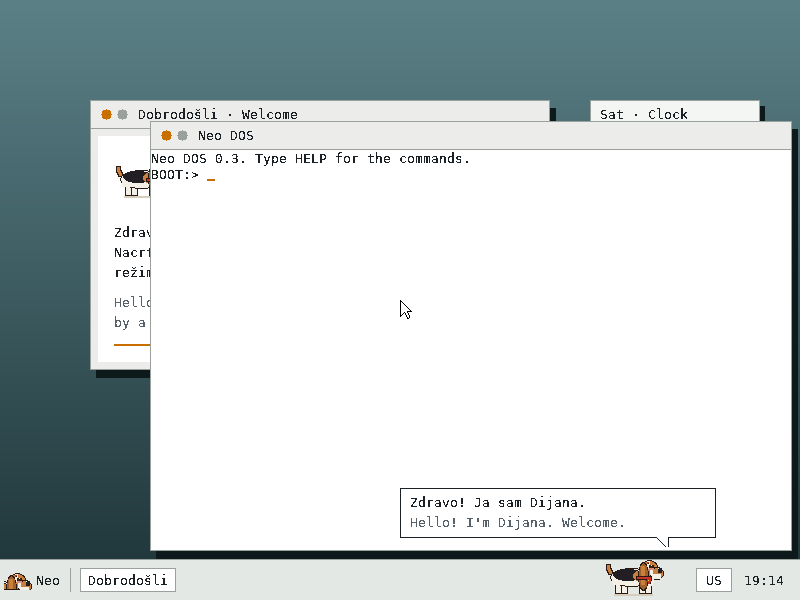
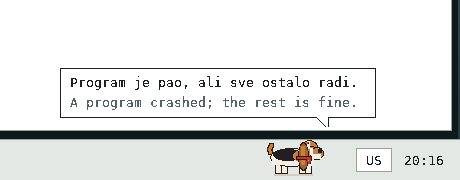
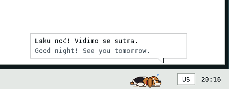

# Dijana, the resident

**English** · [Srpski](MASCOT.sr.md) · 27 November 2026

Dijana is the first resident of the system: a tricolor basset hound who never gets in the way. She is modelled on the owner's own dog. The specification (chapter 8c) describes how she behaves; this page covers how she is drawn and animated.

## Behaviour, from the specification

Sleeps in a corner of the menu bar and raises her ears when she has a useful tip. Speaks up by herself only three times: at first start-up, after an error (with the NEO code), and when called. Sniffs while Find searches. Now and then tries to "eat" a document dragged to the Bin (one click undoes it; can be switched off). Is sad on an error, curls up at "Good night", and in Dijana's Day tells a story that follows the real time of day. She is nearly invisible for experts and never animates on battery.

## On the desk now (step 53)

In Neo Boing Platinum OS Lite she already lives on the Bar, in front of the windows, and her head is the logo at its left end. She greets once at start-up in a speech bubble, breathes and wags, sniffs when the pointer comes close, falls asleep after half a minute without the pointer moving, wakes when it moves, and answers a click on her with a hint. After an error in Neo DOS (an unknown command, a missing file, a program that crashed or ended with an error) she wakes and gives a short tip in Serbian and English; when the system shuts down she says good night and curls up to sleep before the screen goes. The frames come from the pixel sprite sheet through `scripts/make-dijana.py`.

## Two looks

- **Retro** (Lite): small, drawn in pixels. The sprite sheet below.
- **Future Shock**: full animation. The animated vector drawing below.

## Assets (`assets/dijana/`)

| File | What |
| --- | --- |
| `pixel/dijana-sheet.png` and `.json` | 12 frames of 64x48 pixels with durations and tags (Aseprite-style atlas); animations idle, sniff and sleep |
| `pixel/dijana-*.gif`, `dijana-sheet-x4.png` | Previews |
| `svg/dijana.svg` | Vector, static |
| `svg/dijana-animated.svg` | Vector with CSS motion: tail, ear, blink, breathing; respects "reduce motion". CSS animation in SVG works in browsers but not in every renderer, so test it in the toolkit the shell will use |
| `tools/make_sprites.py` | Rebuilds the pixel set (Python and Pillow) |

Not yet drawn: ears up, sad, curled up for the night, walking along the Shelf, the "eat" joke, happy.

## Which animation format

A stack, not one format: the **sprite sheet with a JSON atlas** for the desk and icons (small, fast, any toolkit); **animated SVG** for splash screen, About box and the web; **Lottie** or **Rive** only if she needs smooth vector motion or interaction later. Avoid formats that need a paid runtime. Her events come from the system: she only receives them and never sees files or the network.

## Decided design (27 November 2026)

The owner kept the red scarf and asked for a ladybug and a nicer drawing. The final Dijana is the scarf with a yellow star, the ladybug on her white blaze, and the red toy ladybug at her feet. The vector files are the reference; the pixel sprites follow them. The ladybug walks a little in the animated SVG; the scarf flutters; the toy is only in the vector art.
