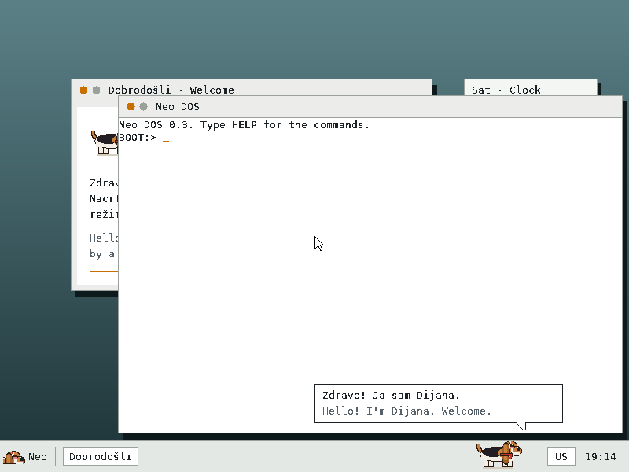
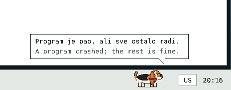
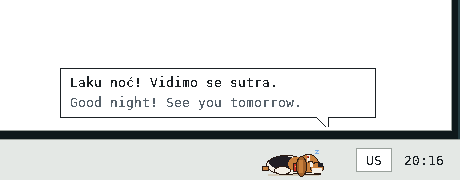

# Dijana, stanar

[English](MASCOT.md) · **Srpski** · 27. novembar 2026.

Dijana je prvi stanar sistema: trobojni baset koji nikad ne smeta. Nacrtana je po vlasnikovom psu. Specifikacija (poglavlje 8c) opisuje kako se ponaša; ova strana opisuje kako se crta i animira.

## Ponašanje, iz specifikacije

Spava u uglu trake menija i podigne uši kad ima koristan savet. Sama se javlja samo tri puta: pri prvom paljenju, posle greške (uz NEO kod) i kad je pozovete. Njuška dok Traži radi. Povremeno pokuša da „pojede” dokument prevučen u Kantu (jedan klik vraća; može da se isključi). Tužna je kod greške, sklupča se na „Laku noć”, a u Dijaninom danu priča priču koja prati pravo doba dana. Za iskusne je skoro nevidljiva i na bateriji se ne animira.

## Već na radnoj površini (korak 53)

U Neo Boing Platinum OS Lite ona već živi na Traci, ispred prozora, a njena glava je logo na levom kraju Trake. Pozdravi jednom pri pokretanju, u oblačiću, diše i maše repom, njuška kad joj se pokazivač približi, zaspi posle pola minuta bez pomeranja miša, probudi se kad se miš pomeri, a na klik odgovori savetom. Posle greške u Neo DOS-u (nepoznata komanda, fajl koji ne postoji, program koji je pao ili završio sa greškom) probudi se i da kratak savet na srpskom i engleskom; kad se sistem gasi, kaže laku noć i sklupča se na spavanje pre nego što se ekran ugasi. Sličice dolaze iz pikselskog lista sprajtova preko `scripts/make-dijana.py`.

## Dva izgleda

- **Retro** (Lite): mala, crtana pikselima. Sprajt-list ispod.
- **Šok budućnosti**: puna animacija. Animirani vektorski crtež ispod.

## Fajlovi (`assets/dijana/`)

| Fajl | Šta |
| --- | --- |
| `pixel/dijana-sheet.png` i `.json` | 12 frejmova od 64x48 piksela sa trajanjem i oznakama (atlas u Aseprite stilu); animacije idle, sniff i sleep |
| `pixel/dijana-*.gif`, `dijana-sheet-x4.png` | Pregledi |
| `svg/dijana.svg` | Vektor, statičan |
| `svg/dijana-animated.svg` | Vektor sa CSS pokretom: rep, uvo, treptanje, disanje; poštuje „smanji pokret”. CSS animacija u SVG-u radi u pregledačima, ali ne u svakom renderu, pa je treba probati u toolkitu koji će shell koristiti |
| `tools/make_sprites.py` | Ponovo pravi pixel set (Python i Pillow) |

Još nisu nacrtani: platinasta loptica za kojom trči, njen šašavi hod (Šašavi mod), podignuta uva, tužna, sklupčana za noć, šetnja duž police, šala „pojede”, srećna.

## Koji format animacije

Kombinacija, ne jedan format: **sprajt-list sa JSON atlasom** za sto i ikone (mali, brz, svaki toolkit); **animirani SVG** za splash ekran, prozor „O sistemu” i veb; **Lottie** ili **Rive** tek ako kasnije zatreba glatko vektorsko kretanje ili interakcija. Izbegavati formate koji traže plaćen runtime. Događaje dobija od sistema: samo ih prima i nikad ne vidi fajlove ni mrežu.

## Odlučen dizajn (27. novembar 2026)

Vlasnik je zadržao crvenu maramu i tražio bubamaru i lepši crtež. Konačna Dijana ima maramu sa žutom zvezdom, bubamaru na beloj pruzi na čelu i crvenu igračku bubamaru kraj nogu. Vektorski fajlovi su uzor; pixel sprajtovi ih prate. Bubamara malo šeta u animiranom SVG-u, marama se leluja, a igračka postoji samo u vektorskom crtežu.

## Dijana i platinasta loptica (28. novembar 2026)

Dijanina igračka, pored bubamare, je **platinasta loptica** (*Skočica*): naša srebrna loptica sa malom crvenom zvezdom, nikad šahovska Amiga Boing Ball lopta. Klikni na Dijanu pet puta na demo strani i loptica upadne i skače; na stolu će se ponekad otkotrljati duž Trake dok je Dijana prati pogledom, i pasti na komad platine na ekranu pri paljenju. Ona izgovara haiku i rečenice dana sistema, pozdravlja računar imenom koje si mu dao, a u Šašavom modu prelazi preko ekrana smešnim hodom. Sve je u [EASTER-EGGS.sr.md](EASTER-EGGS.sr.md).
