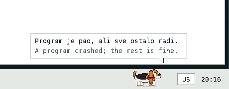
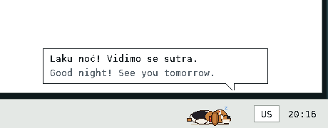
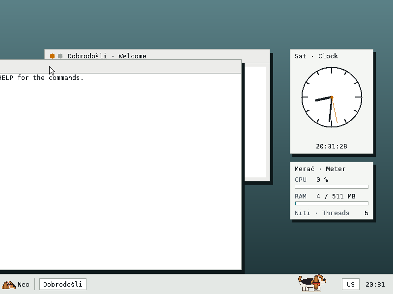
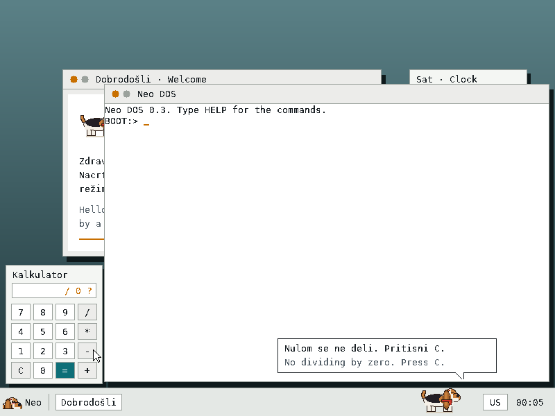
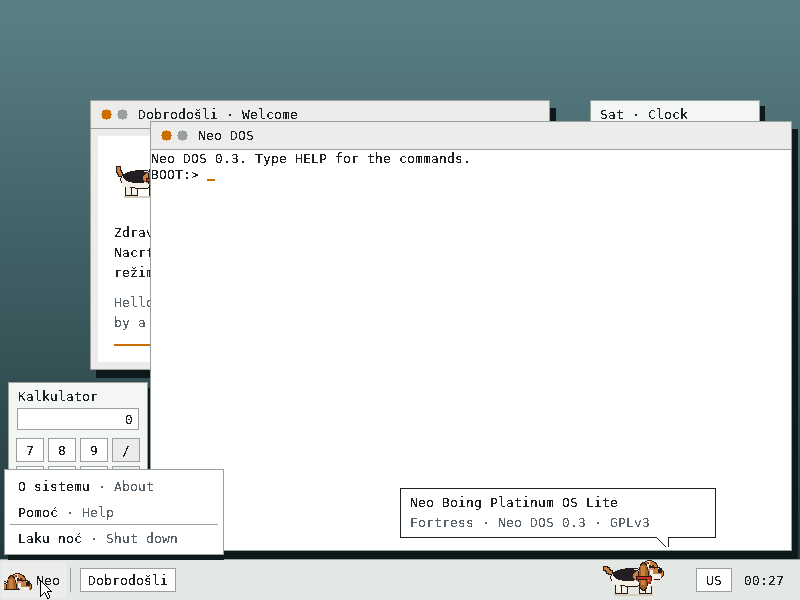
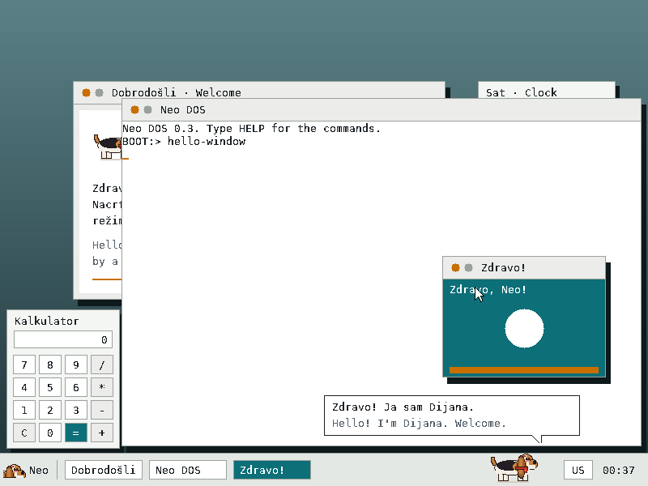
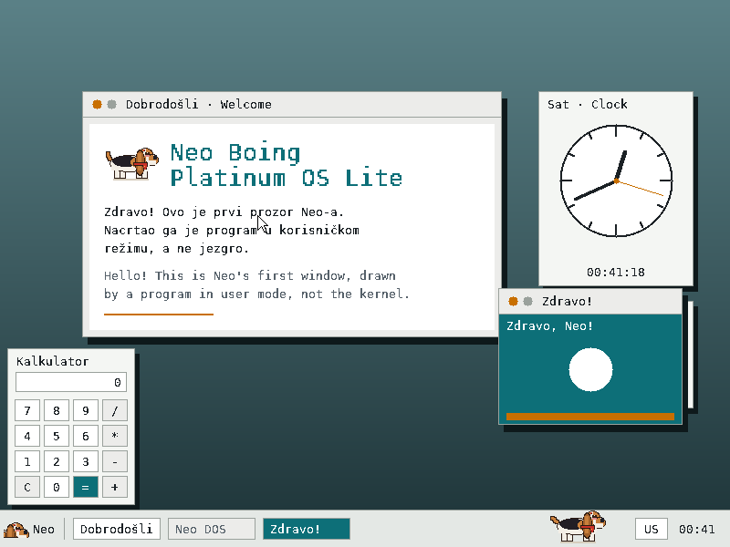
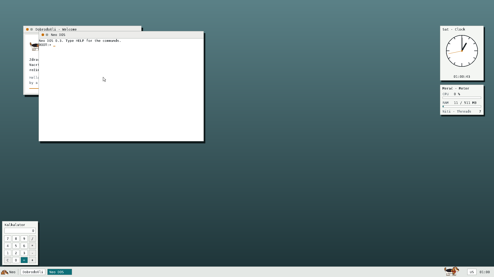

# Progress log

Neo OS Lite is coded in small steps. Each step must build and pass its boot
test before the next one starts. This file says where the work stopped, so the
next session can pick it up without asking.

## Done

### Step 1: Fortress boots on x86_64 (2026-11-13)

- `fortress/`: a `no_std` Rust kernel for `x86_64-unknown-none`.
- Boots through the PVH protocol, so `qemu-system-x86_64 -kernel` loads it
  directly with no boot loader. `boot.S` builds identity page tables for the
  first 1 GiB, enters long mode and calls `kmain`.
- Prints a banner, the firmware memory map, usable RAM and the kernel command
  line on COM1.
- `neo.test` on the command line makes it exit QEMU through `isa-debug-exit`
  (status 33 = pass), which the boot test and CI use.
- Run: `./scripts/run-x86_64.sh`. Test: `./scripts/test-boot-x86_64.sh`.

### Step 2: CPU exceptions (2026-11-13)

- `arch/x86_64/idt.rs` and `isr.S`: an IDT with entry stubs for all 32 CPU
  exceptions. Each stub saves every register and calls `exception_dispatch`.
- A breakpoint (`int3`) is reported and execution continues. Any other
  exception prints its name, the error code, all registers (and for a page
  fault the address and the kind of access) and panics.
- The panic handler prints the message and source location and exits QEMU
  with status 35.
- Boot tests: `neo.test` now also checks that a breakpoint is caught;
  `neo.test=pagefault` reads unmapped memory and checks the report.
- Known gap: no TSS or separate double-fault stack yet, so a kernel stack
  overflow still resets the machine instead of being reported. That comes
  with the kernel's own GDT in step 3 or 4.

### Step 3: physical memory (2026-11-13)

- `mem/frame.rs`: a bitmap frame allocator (one bit per 4 KiB frame), filled
  from the firmware memory map. The first 1 MiB, the kernel image and the
  loader's data (start info, memory map, command line) are kept out.
- Hands out the lowest free frame first; freeing a frame twice panics.
- `sync.rs`: a minimal spin lock that keeps the allocator's state behind a
  safe interface.
- Self-test: three frames are distinct, page aligned, outside the kernel and
  writable; a freed frame is handed out again; the free count returns to
  where it started.
- Limit for now: only RAM below 1 GiB is managed, because only that is
  mapped. Checked with `-m 3G`: it boots and reports 1022 MiB managed.

### Step 4: the kernel's own page tables, GDT and TSS (2026-11-13)

- `arch/x86_64/gdt.rs`: the kernel's GDT with a TSS; interrupt stack 1 is a
  separate 16 KiB stack used only by the double-fault handler.
- `arch/x86_64/paging.rs`: 4-level page tables built from allocator frames.
  Physical memory is identity mapped up to 4 GiB or the end of RAM,
  whichever is higher (2 MiB pages; 4 KiB pages around the kernel image).
  `translate()` walks the tables.
- The page below the boot stack is left unmapped, so a stack overflow hits
  the guard page and is reported as a double fault instead of resetting the
  machine or silently overwriting memory.
- Fixed a latent bug: the linker put `.got` after `__kernel_end`, so the frame
  allocator could hand out (and page-table code zero) the kernel's GOT. `.got`
  now lives inside `.data`.
- Boot tests: page-table self-test (guard unmapped, kernel and local APIC
  mapped) and `neo.test=stackoverflow`. Also checked by hand with `-m 6G`.
- Not yet: no NX or read-only kernel text; everything is mapped writable.

### Step 5: all RAM and a kernel heap (2026-11-13)

- The frame bitmap is now sized from the memory map and stored in RAM (16 KiB
  for 512 MiB, 256 KiB for 8 GiB) instead of a fixed 1 GiB array. Frames are
  handed out only below a limit: 1 GiB at boot, raised to everything the
  kernel's page tables map once they are active.
- `mem/heap.rs`: the kernel heap, a first-fit free list sorted by address
  that merges neighbouring blocks on release. It starts empty at
  `0xFFFF_9000_0000_0000` and grows by mapping fresh frames (64 KiB at a time,
  up to 256 MiB). `Box`, `Vec` and `String` now work in the kernel.
- Heap self-test: a 100 000-element `Vec`, 1000 boxes freed and refilled in a
  checkerboard, a page-aligned allocation, a `String`; at the end every byte
  must be free again in a single block.
- Checked by hand: `-m 6G` (6142 MiB free, frames above 4 GiB usable) and a
  debug build (overflow checks and debug assertions on).

### Step 6: timer and preemptive scheduler (2026-11-13)

- `arch/x86_64/apic.rs`: the legacy PICs are remapped to 0xF0-0xFF and
  masked; the local APIC timer is calibrated against PIT channel 2 and runs
  periodically at 100 Hz on vector 32.
- The IDT now has stubs for all 256 vectors; vectors from 32 up go to the
  device interrupt dispatcher (timer, spurious, unexpected).
- `sync.rs`: the spin lock now turns interrupts off while held, so a timer
  interrupt can never switch away from a thread holding the heap or frame
  lock and deadlock the single core.
- `sched.rs`: kernel threads with 16 KiB heap stacks, a round-robin scheduler
  with a 2-tick (20 ms) time slice, `spawn`, `yield_now` and `exit`. The
  `kmain` context becomes thread 0. Ended threads' stacks are freed on the
  next switch. The context switch saves only callee-saved registers; a
  preempted thread's interrupt frame stays on its own stack.
- Self-test: three busy threads that never yield all make progress for
  0.3 s (preemption works), then stop and are cleaned up. Repeated 5 times
  in release and 3 times in a debug build.

### Step 7: sleeping, parking and an idle thread (2026-11-13)

- `sched::sleep(ticks)`: the thread is not scheduled again until the timer
  reaches that tick. The timer wakes sleepers and leaves idle at once.
- `sched::park()` / `unpark(id)`: block until another thread wakes you. An
  unpark that arrives early is remembered, so a wake-up is never lost. This
  is the building block for wait queues and message ports.
- An idle thread halts the CPU (`sti; hlt`) and runs only when nothing else
  is ready, so a waiting system no longer spins.
- Self-test: a 10-tick sleep takes 10 ticks and lets idle run; yielding with
  nothing else ready does not switch; a parked thread is woken once by an
  unpark, and a second unpark sent before it parks again is not lost.

### Step 8: message ports, the seed of Exec-N (2026-11-13)

- `ipc.rs`: a `Port` is a bounded message queue. `send` waits while it is
  full, `recv` waits while it is empty; waiting threads park and the other
  side unparks them. `call` sends a request with a fresh reply port and waits
  for the answer.
- Ports can be published under a name (`publish`, `find`, `withdraw`), so a
  client finds a service by name, Amiga style.
- A `Message` is a tag, three words of payload and an optional reply port.
- Self-test: 1000 messages through a 4-slot port arrive complete and in
  order (both sides block in turn); a small "adder" service publishes its
  port, answers 20 calls, then quits and withdraws its name.
- Kernel threads only for now; real Exec-N passes messages between address
  spaces over shared-memory rings.

### Step 9: programs in user mode and system calls (2026-11-13)

- GDT gains user code and data segments (ring 3) in the order `syscall` and
  `sysret` need; the TSS `rsp0` and the syscall entry stack are set to the
  running thread's kernel stack on every switch.
- `paging.rs`: an address space per program. It shares the kernel mappings
  (supervisor-only, so the program cannot touch them) and has its own user
  part in PML4 slots 1-255; `destroy_user` frees all of it.
- `process.rs`: loads a raw machine-code image read-only at
  `0x80_0000_0000`, a 16 KiB stack below `0x80_1000_0000`, and drops to ring 3.
  The thread switch also switches the address space.
- `syscall.rs`: `exit`, `print`, `find_port`, `send`, `sleep` through the
  `syscall` instruction. Every pointer is checked against the program's own
  mapped memory; caller-saved registers come back zeroed.
- A fault in user mode stops only that program, with a report; the kernel
  carries on.
- `programs/`: four tiny test programs in assembly. The self-test checks
  that `hello` prints, finds a port by name and sends a message; `badptr`
  gets an error instead of reading kernel memory through `print`; `peek`
  (reads kernel memory) and `halt` (privileged instruction) are stopped;
  every thread, page table and frame is given back afterwards.
- Not yet: programs are raw images (no ELF loader), no NX bit, one thread
  per program, ports are found by name with no access rights yet.

### Step 10: capabilities and a first service in user mode (2026-11-13)

- A program's handle table now holds capabilities: a port plus rights
  (send, receive). A program starts with only the handles its creator gives
  it; it gains more by receiving a reply port in a message (send right only)
  or by looking a name up, which needs the `lookup` permission.
- New system calls: `recv` (blocks; fills tag, two words, sender and reply
  handle into the program's buffer, which must be its own writable memory),
  `call` (send and wait for the answer) and `close`. `send` now takes a tag.
  Errors: `ERR_DENIED` for a missing right, `ERR_BAD_HANDLE` for no handle.
- Test programs: `doubler`, a service in user mode that answers requests
  on the port it was given; `client`, which holds only the send right to it.
  The client checks that receiving, looking up names and using a handle it
  does not have are all refused, then calls the service and gets 42. The
  kernel calls the same service too, then tells it to quit.

### Step 11: programs written in Rust, loaded from ELF (2026-11-13)

- `user/`: a separate Cargo workspace for programs. `neo-rt` is their
  runtime: `_start`, safe wrappers for every system call (`Result` with an
  `Error` enum), `print!`/`println!` and a panic handler. Programs are
  compiled position-independent and linked at `0x80_0000_0000` with
  `user.ld` (one page-aligned segment per kind of access).
- `user/hello-rust`: the first Rust program. It prints, computes fib(50),
  checks that receiving, an unknown handle and name lookup are all refused,
  sends its result on the handle it was given and exits with 7.
- `fortress/build.rs` builds the `user/` workspace on every kernel build and
  the kernel embeds the ELF files (`include_bytes!`).
- `elf.rs`: a bounds-checked ELF64 reader. `process::spawn_elf` maps each
  loadable segment with its own rights (read-only code, writable data),
  zero-fills the rest, and refuses segments outside the program's part of
  memory, overlapping or unaligned segments and an entry point outside code.
- Self-test: hello-rust runs and reports; four damaged files (bad magic,
  wrong machine, a segment aimed at the kernel, truncated headers) are
  refused; no frame is leaked.

How to write a program: copy `user/hello-rust`, add it to `user/Cargo.toml`
and to the list in `fortress/build.rs`, then start it with
`process::spawn_elf`.

### Step 12: the console as a service in user mode (2026-11-14)

- A second kind of capability: `Cap::Io { base, len }`, a range of x86 I/O
  ports. System calls 8 `io_out` and 9 `io_in` need such a handle and an
  offset inside its range; a port handle gives `Denied`, a missing one
  `BadHandle`.
- `user/console`: the console service. It is given a receive right on its
  request port (handle 0) and the eight UART registers of COM1 (handle 1),
  and is the only program that touches the serial port. It waits for the
  transmitter to be free (LSR bit 5) and writes each byte (THR), turning
  `\n` into `\r\n`. It checks that offset 8 is refused.
- Protocol (in `neo-rt`): tag `1 | len << 8` carries up to 16 bytes packed
  little-endian in a0/a1; tag 2 stops the service, which exits with the
  number of characters printed. `neo_rt::console_write` and
  `ConsoleClient` (a `fmt::Write`) split text into such messages.
- `user/hello-console`: prints two lines through the service with only a
  send right, and checks it cannot use I/O itself.
- Self-test: both programs run, the text appears, the service stops on
  request, all threads end and no frame is leaked.

The kernel's own `print` call stays for now (early programs and panics);
new programs should print through the console service.

### Step 13: Fortress boots on AArch64 (2026-11-14)

- `arch/aarch64`: entry for the QEMU `virt` machine. Core 0 boots and the
  others wait. If started in EL2 it drops to EL1. It turns on FP/SIMD, zeroes
  `.bss`, and switches the MMU on with a boot identity map of the first
  4 GiB in 1 GiB blocks (the first as device memory, the rest as cached RAM).
  The kernel is linked at 0x4020_0000.
- `vectors.S`: all 16 exception vectors save the registers and call Rust. A
  `brk` is counted and skipped. Anything else is reported (kind, cause, ESR,
  FAR, ELR, SPSR, x0-x30) and stops the kernel.
- `fdt.rs`: a small device tree reader with no heap. It finds RAM, the
  reserved areas and the command line (`/chosen/bootargs`). The tree comes
  in x0, or from the start of RAM where QEMU puts it for ELF kernels.
- The serial console is the PL011 UART. QEMU is left through semihosting,
  with the same exit statuses as on x86_64 (33 pass, 35 fail).
- The frame allocator is shared with x86_64. `main.rs` now holds only what
  both architectures share; the x86_64 boot path moved to
  `start_x86_64.rs`, and the new one is `start_aarch64.rs`.
- `scripts/test-boot-aarch64.sh` boots three times: the normal self-test,
  an undefined instruction that must be reported, and a 2-core, 1 GiB
  machine started in EL2. CI runs it next to the x86_64 test.

Build for AArch64 with `cargo build --release --target aarch64-unknown-none`.

### Step 14: AArch64 gets its own page tables and a heap (2026-11-14)

- `arch/aarch64/paging.rs`: 4 KiB pages, four levels, 48-bit addresses.
  As on x86_64, memory is identity mapped up to 4 GiB or the end of RAM,
  with 2 MiB blocks except around the kernel, where 4 KiB pages leave the
  page under the boot stack unmapped as a guard. RAM regions from the
  device tree are normal cached memory; everything else is device memory
  that can never be executed.
- One top-level table serves both halves (TTBR0 and TTBR1), the way x86_64
  uses one PML4, so the kernel heap at `0xFFFF_9000_0000_0000` works on
  AArch64 without changes.
- Kernel stack overflow: every exception taken in the kernel first checks
  (with `AT S1E1W`) that its register frame fits on the current stack. If
  not, it switches to a small emergency stack, so the overflow is still
  reported instead of looping.
- Data aborts are reported as page faults (address, read or write, missing
  or protected page, kernel or user mode).
- The heap test and the stack overflow helper are shared by both
  architectures now (`main.rs`).
- Boot test: page tables and heap self-tests, plus a page fault and a stack
  overflow boot, as on x86_64.

### Step 15: timer, interrupts and threads on AArch64 (2026-11-14)

- `arch/aarch64/gic.rs`: the GICv2 interrupt controller of QEMU `virt` and
  the EL1 virtual timer (interrupt 27) at 100 Hz. When started in EL2, the
  entry code lets EL1 use the timer and zeroes the virtual offset.
- Every exception now also saves the FP/SIMD registers (q0-q31, FPSR,
  FPCR), because the kernel itself uses them; `switch_context` keeps x19-x30
  and d8-d15, the registers a function call must preserve.
- The scheduler, sleeping, parking and message ports from x86_64 run
  unchanged on AArch64. `sched.rs` only leaves out user programs there.
  The thread, sleep and port self-tests moved to `thread_tests.rs`, shared
  by both architectures.
- New self-test on both: two threads do floating-point work while the timer
  preempts them, and their results must match the same work done without
  interruption. Without the FP save in the exception entry it fails.
- The AArch64 boot test checks the timer, scheduler, sleep, ports and FP
  tests, also on the 2-core machine started in EL2.

### Step 16: programs in user mode on AArch64 (2026-11-14)

- Programs, capabilities, the ELF loader and system calls (`process.rs`,
  `syscall.rs`, `elf.rs`) are now shared by both architectures. Only the
  I/O-port calls 8 and 9 stay x86_64-only.
- AArch64 address spaces: each program has its own top-level table in
  TTBR0 that shares the kernel's entries (EL1 only) and adds slots 1..255,
  the same program addresses as on x86_64. Writable program pages are
  never executable, and the kernel can execute none of them. Switching
  threads loads TTBR0 and drops stale translations.
- Entering EL0 clears every general and FP/SIMD register. `svc #0` with the
  call number in x8 and arguments in x0-x3 reaches the same
  `syscall_dispatch`. Any other exception from EL0 stops only that program.
  The exception frame now keeps the program's stack pointer (SP_EL0).
- `neo-rt` has an AArch64 `_start` and system call stub; `fortress/build.rs`
  builds the user programs for the kernel's own processor.
- `user/crash`: a program that reads kernel memory. On both architectures
  it is stopped, the kernel carries on and no frame leaks.
- `hello-rust` and its checks run unchanged on AArch64. The Rust program
  tests moved to `program_tests.rs`, shared by both.

### Step 17: a boot image with the programs (2026-11-14)

- `bootfs.rs`: a read-only file system in memory, the boot image the
  loader puts next to the kernel (QEMU `-initrd`). The format is a plain
  ustar archive. Every header checksum and size is checked, so a damaged
  image is refused instead of being read past its end.
- x86_64 finds the image as the first PVH module. AArch64 finds it in the
  device tree (`linux,initrd-start` / `-end`). Both keep its memory away
  from the frame allocator.
- AArch64 kernels now start with the 64-byte header of the arm64 Linux
  boot protocol, and `scripts/elf2image.py` turns the ELF file into the raw
  Image. QEMU passes the device tree and the boot image only to such
  images, and U-Boot and the Raspberry Pi firmware use the same protocol.
  The ELF file still boots.
- `scripts/make-bootfs.sh x86_64|aarch64` builds the user programs and
  packs them under `bin/`. The boot tests pass the image. The self-test
  lists it, runs `bin/hello-rust` from it, and checks that two damaged
  copies are refused.
- AArch64 user programs are linked with 4 KiB segment alignment, which
  makes them about 5 times smaller.

### Step 18: programs read files and start programs (2026-11-14)

- Two new kinds of capability: `BootDir` (may list the boot image and open
  its files) and `File` (one read-only file: read it, or start it as a
  program).
- System calls 10-15: `open`, `read`, `list`, `spawn`, `wait`,
  `file_size`. A program's file name in the image becomes its thread name.
  `spawn` passes the new program a copy of one handle as its handle 0.
  `wait` works only on programs the caller started, and returns -255 for
  one the kernel had to stop. Every buffer is checked against the
  program's own memory.
- `neo-rt` wraps all of them.
- `user/runner`, started from the boot image with only a `BootDir` handle:
  it lists the image, reads README in two pieces, starts `bin/crash` and
  waits for it to be stopped, and checks that a missing file, a file used
  as a directory, a directory read as a file, waiting for someone else's
  program and a kernel buffer are all refused. The self-test checks its
  exit code on both architectures.

### Step 19: Neo DOS, the first command line (2026-11-14)

- Keyboard input over the serial console on both architectures
  (`arch::getc`). A new `Console` capability, and system call 16
  `read_input`, which waits until something is typed. There is no serial
  interrupt yet, so it looks every tick.
- `user/neodos`: Neo DOS 0.1, in the spirit of AmigaDOS. It has `DIR`,
  `TYPE`, `RUN` (a program's name alone works too, with or without `bin/`),
  `ECHO`, `VERSION`, `HELP` and `ENDCLI`. It echoes typed text and handles
  backspace. A started program gets the boot image as its handle 0. When
  the system stops a misbehaving program, Neo DOS says so and carries on.
- `neo.shell` on the kernel command line starts Neo DOS from the boot image
  with only the image and the console as handles. QEMU ends with status 33
  when it leaves with `ENDCLI`.
- Both boot tests type a short session (help, dir, type, a crashing
  program, an unknown command, echo, endcli) and check the answers.

Try it: `qemu-system-x86_64 -machine q35 -m 512M -nographic -kernel
target/x86_64-unknown-none/release/fortress -initrd "$(scripts/make-bootfs.sh
x86_64)" -append neo.shell`.

### Step 20: a disk (virtio block device) (2026-11-14)

- `virtio_blk.rs`: a legacy virtio block driver. It handles PCI on x86_64
  (`virtio-blk-pci,disable-modern=on`, registers on I/O ports, found by
  scanning PCI bus 0) and memory-mapped registers on AArch64 (the `virt`
  machine's 32 virtio-mmio slots). Only register access differs between
  the two; the request queue code is shared.
- One queue, one request at a time, waiting by polling. Reads of up to 8
  sectors are checked against the disk's size and the device's status.
  The driver is in the kernel as a bootstrap and will move to a driver
  process in user mode later.
- The frame allocator can now hand out physically contiguous frames,
  which the queue needs.
- PCI configuration access and 16- and 32-bit port I/O on x86_64.
- `diskfs.rs`: the same ustar file system as the boot image, read from the
  disk sector by sector. Listing reads only the headers, and a file's bytes
  are read when it is opened.
- Self-test, with the boot image copied onto the disk: list the disk,
  check that README is the same on disk and in the boot image, refuse a
  missing file and a read past the end, and run `bin/hello-rust` read from
  the disk. No frame may leak.

### Step 21: Neo DOS volumes, BOOT: and DH0: (2026-11-14)

- A directory handle now names its volume: the boot image (`BOOT:`) or the
  disk (`DH0:`). `open`, `read`, `list` and `spawn` work the same on both;
  a file read from the disk is held in memory while a handle refers to it.
- The disk now has its own contents (README "Neo OS Lite disk DH0:" and the
  programs), built by `make-bootfs.sh ARCH disk`.
- Neo DOS 0.2 gets the disk as handle 2 when there is one. New commands:
  `CD vol:` (or just `vol:`), `INFO` (volumes and sizes), and `DIR vol:`.
  The prompt shows the current volume, `BOOT:>` or `DH0:>`.
- The boot tests on both architectures switch to `DH0:`, list it, show its
  README and run a crashing program from the disk; Neo DOS carries on.

### Step 22: typed input by interrupt (2026-11-14)

- The serial port now interrupts when a byte arrives: on x86_64 through
  the I/O APIC (ISA IRQ 4, with OUT2 set on the UART), on AArch64 as
  shared interrupt 33 of the GIC (PL011 receive interrupts).
- `input.rs`, shared by both: the handler moves the bytes into a 256-byte
  buffer and wakes the reading thread. A reader with nothing to read parks,
  so a waiting Neo DOS no longer wakes up every tick. A byte that arrives
  between the check and the park leaves an unpark behind and is not lost.
- On AArch64 the UART's interrupt is cleared before the bytes are read, not
  after: clearing it afterwards lost a byte that came in meanwhile, and
  input stopped after the first key.
- When Neo DOS ends, the kernel reports how many input interrupts it took;
  the boot tests on both architectures require at least one.

### Step 23: a keyboard driver in user mode (2026-11-14)

- Two new kinds of capability. An interrupt handle (`Cap::Irq`) lets a
  driver wait on one interrupt line with the new `irq_wait` call; the
  kernel's handler only counts the interrupt and wakes the driver. A
  typing handle (`Cap::Typing`) lets a driver add bytes to what the
  console reads, with the new `type_byte` call. The kernel can take a line
  back (`irq::revoke`), and the driver's wait then fails so it can end.
- `bin/keyboard` (x86_64): the PS/2 keyboard driver. It gets the
  controller's five ports, IRQ 1 and a typing handle, turns on the
  keyboard interrupt and scan code translation, and turns set 1 scan codes
  into characters (US layout, Shift and Caps Lock).
- The I/O APIC now routes ISA interrupts generally (line n to vector
  32 + n); IRQ 1 goes to the driver.
- With `neo.shell` the kernel starts the keyboard service next to Neo DOS,
  so typing in the QEMU window works as well as typing on the serial line.
- Self-test: the PS/2 controller's command 0xD2 presses keys with no one at
  the keyboard (Shift+H, I, space, 4, 2, Enter); Neo DOS's input must read
  `Hi 42` and a newline, the driver must end with 6 when its line is taken
  back, and no frame may leak.
- A fifth boot test types `echo Typed on PS/2!` and `endcli` with QEMU's
  monitor (`scripts/sendkeys.py`), through the real emulated keyboard.

### Step 24: a keyboard on AArch64 too (virtio-input) (2026-11-14)

- `virtio_input.rs`: the virtio keyboard of the `virt` machine
  (`-device virtio-keyboard-device`), legacy MMIO, by interrupt. The driver
  offers 64 event buffers; the device writes 8-byte input events into them
  and raises its interrupt (shared interrupt 16 + slot, INTID 48 + slot).
  The handler turns key presses into characters for the console input and
  offers the buffers again.
- `keymap.rs`: Linux key codes and PS/2 set 1 scan codes agree for the
  usual keys, so one US table with Shift and Caps Lock serves both.
- Like the disk driver, this one lives in the kernel as a bootstrap; on
  x86_64 the keyboard driver already runs in user mode. It moves out once
  a driver can be given device memory and DMA buffers as capabilities.
- A seventh AArch64 boot types `echo Typed on virtio!` and `endcli` with
  QEMU's monitor, and Neo DOS runs them.

### Step 25: the first window, drawn from user mode (2026-11-14)

- A new capability for device memory (`Cap::Mem`) and the `map_device`
  call (19): a driver maps a device's memory into its own address space,
  in a 1 GiB window above its code. Such pages are marked as device memory
  in the page tables (a free bit on both architectures), so they never go
  back to the frame allocator when the program ends.
- Port I/O calls now take a width (1, 2 or 4 bytes); the whole access must
  be inside the program's range.
- `display.rs` (x86_64) finds the PC's standard VGA card under QEMU (the
  Bochs display, PCI 1234:1111) and its framebuffer.
- `bin/display`: the display service. It gets the card's mode registers,
  its framebuffer and the clock chip's ports; it sets 800 x 600 at 32 bits
  and draws the desk: wallpaper, the Bar, a first window (in Serbian and
  English) and the Clock tile with the time from the clock chip. Text uses
  an 8x16 font made from DejaVu Sans Mono by `scripts/make-font.py`, with
  the Serbian Latin letters.
- `neo.shell` draws the desk before Neo DOS starts.
- Self-test: the service draws, ends with 0, and the kernel finds the right
  colours at five places in the framebuffer; no frame leaks.

### Step 26: the clock ticks (a display service that keeps running) (2026-11-14)

- `recv` (call 5) can now poll: with the flag set it returns at once with
  "not found" when the port is empty. `neo-rt` has `try_recv`.
- `bin/display` is now a service that keeps running. It draws the desk once,
  then reads the clock chip a few times a second and redraws only the Clock
  tile's face, the digits and the time on the Bar when the second changes.
  A message on its control port (tag 2) stops it; it ends with the number
  of redraws.
- `neo.shell` starts the display service beside Neo DOS instead of waiting
  for it, and stops it when Neo DOS ends ("Display service stopped after N
  clock redraws.").
- Self-test: the kernel lets the service run for 2.5 s, checks the pixels
  while it is still running, stops it and expects at least two redraws and
  no frame leaks.

### Step 27: the screen on AArch64 too (ramfb) (2026-11-14)

- `display.rs` is now shared by both architectures. On AArch64 the kernel
  finds QEMU's firmware interface (fw_cfg), looks up `etc/ramfb`, takes
  469 contiguous pages of RAM for an 800 x 600 framebuffer and hands its
  address over with one DMA write. It does this once at boot ("Screen:
  ramfb 800x600 at ...").
- The same `bin/display` program runs on both. Its handles are now: 0 the
  framebuffer, 1 its control port, 2 the clock (CMOS ports on a PC, the
  PL031 chip's page on AArch64), and on a PC 3 the card's mode registers.
- `neo.shell` starts the display service on AArch64 as well; the boot image
  there has 6 files.
- Self-test on AArch64 (with `-device ramfb`): the same five pixels, at
  least two clock redraws, no frame leaks. Without a screen it is skipped.
- Screenshot: `docs/img/first-window-aarch64.png`.

### Step 28: the mouse and the pointer (2026-11-14)

- `pointer.rs`: the kernel keeps the pointer's position (inside the screen)
  and buttons, and tells the display service of each change on its control
  port (tag 3), without waiting: if the service is behind, a move is
  dropped and the next one carries the new position.
- A new pointer capability (`Cap::Pointer`) and call 20 (`pointer_move`).
- Call 17 (`irq_wait`) can wait on two interrupt lines at once
  (`irq_wait_either`). The PC's PS/2 controller driver (bin/keyboard) uses
  it to run the mouse too, on IRQ 12: it turns 3-byte packets into moves.
- AArch64: virtio-input now drives up to four devices; mice (relative) and
  tablets (absolute) move the pointer, keyboards type as before.
- The display service draws an arrow at the pointer, keeping what it covers,
  and lifts it while the clock is redrawn. It now looks for work every
  20 ms.
- Self-test on x86_64: three mouse packets injected through the controller
  (command 0xD3) put the pointer at (440, 330) with the left button down and
  the arrow drawn there. Shell boots on both architectures move the mouse
  through QEMU's monitor and check where the pointer ends up.
- Screenshot: `docs/img/pointer.png`.

### Step 29: windows that move (2026-11-14)

- The display service keeps its desk as a small scene (wallpaper, the
  Clock tile, the first window, the Bar on top) and repaints only a
  rectangle of it, back to front, with clipping: when the window moves,
  the area it left and the area it covers; when the clock ticks, the tile
  and the Bar's time (under the window, if the window is over them).
- Press the left button on the window's title bar and move: the window
  follows the pointer. Its title bar stays on the desk, above the Bar.
- Self-test on x86_64: injected mouse packets grab the title bar and drag
  the window from (90, 100) to (190, 250); the kernel finds the title bar
  at the new place and the wallpaper at the old one.
- Screenshot: `docs/img/window-dragged.png`.

### Step 30: a contributor guide (2026-11-14)

- `CONTRIBUTING.md` (English) and `CONTRIBUTING.sr.md` (Serbian): what is
  needed, building and testing, the code's layout, the rules a change must
  keep, and how to add a program, a service and a system call, with first
  tasks.
- `rustfmt.toml` (lines up to 120 characters): all code formatted with it,
  and CI checks the formatting.
- The system call table at the top of `syscall.rs` now lists calls 17-20
  and the newer arguments.

### Step 31: windows for programs, through shared memory (2026-11-14)

- Shared memory: call 21 (`share`) makes a block of zeroed, contiguous
  pages (`Cap::Shared`), which `map_device` maps as ordinary memory. The
  block is freed when the last handle and the last mapping are gone; a
  mapping keeps it alive even if the handle is closed. `file_size` on such
  a handle gives its size.
- Handles in messages: call 22 (`send_handle`) sends a copy of one of the
  sender's handles with a message; `recv` now fills six words, the sixth
  being the handle that came along (or none).
- The display service publishes its port as "display". A program sends
  `WINDOW_TITLE` (8 bytes of title), then `WINDOW_OPEN` with its pixels'
  shared memory and size, and `WINDOW_DRAWN` after drawing. The service
  checks the size against the block, maps it, frames it with a title bar
  and copies it to the screen inside the clip. Up to three program
  windows, each dragged like the first, topmost first.
- Programs started by Neo DOS may look ports up when Neo DOS may, so
  `hello-window` (new) runs from the command line.
- Self-test on both architectures: hello-window opens its window; the
  kernel finds its pixels and title bar on the screen, then stops the
  service and checks that no frame leaked (the shared block included).
- Screenshot: `docs/img/program-window.png`.

### Step 32: clicks reach windows; a click raises a window (2026-11-14)

- Programs can make message ports (call 23, `new_port`) and send without
  waiting (call 24, `try_send`). A port passed in a message keeps only its
  send right, so the receiver can send to it but not read it.
- A window's program may pass an event port (`WINDOW_EVENTS`) before
  `WINDOW_OPEN`. Clicks inside the window's pixels reach it as
  `EVENT_CLICK` (position inside the window and the buttons just
  pressed); the display service never waits on a slow program. When the
  service stops, every such program gets `EVENT_QUIT`.
- Pressing any button on a window raises it in front of the others; the
  title bar still drags it. `WINDOW_CLOSE` takes a program's window away.
- hello-window answers clicks: left turns its disc amber (or white again),
  right closes the window; it also ends on `EVENT_QUIT` or after 30 s.
- Self-test on x86_64: injected mouse moves and clicks turn the disc and
  then close the window; the program ends with 1 change.
- Screenshot: `docs/img/window-raised.png`.

### Step 33: keys go to the window in focus (2026-11-14)

- A key focus capability (`Cap::KeyFocus`) and call 25 (`focus_keys`):
  the holder says which port keyboard bytes go to. While a window has the
  focus, what the PS/2 or virtio keyboard types reaches its program as
  `EVENT_KEY` (never waiting on it) instead of Neo DOS; the serial console
  always types into Neo DOS.
- The display service holds it (handle 3; the PC's mode registers moved to
  handle 4). A new program window gets the focus; a click gives it to the
  window clicked, or back to the console when the click is on the desk or
  the first window; closing the window or stopping the service gives it
  back too.
- hello-window: A turns the disc amber or white, Q closes the window.
- Self-test on x86_64: after a click, A and Q typed on the PS/2 keyboard
  reach the window and not the console; after the window closes, X reaches
  the console again.

### Step 34: neo-gfx, drawing and text for every program (2026-11-14)

- `user/neo-gfx` (new library): `Canvas` over 32-bit pixels with a clip
  rectangle: rectangles, outlines, discs, rings, lines and text in the Neo
  8x16 font (which moved here from the display service; `make-font.py`
  writes it here now). `Window` opens a window through the display service
  in one call and turns its messages into events (`Click`, `Key`, `Quit`).
- The display service draws the desk with the same canvas.
- hello-window uses it: a greeting at the top, typed keys appear on a line
  (Backspace removes one), Esc or a right click closes the window, a left
  click turns the disc. It ends with ten times the colour changes plus the
  line's length.
- Self-test on x86_64: "hi" typed on the PS/2 keyboard shows in the window,
  Esc closes it, the program ends with 12.
- Screenshot: `docs/img/typing-in-window.png`.

### Step 35: Neo DOS in a window (the terminal) (2026-11-14)

- The kernel can copy what programs print on the console to a port
  (`console::set_tee`), 16 bytes per message, never waiting on it.
- `bin/terminal` (new): opens an 80 x 25 window through the display
  service, draws the console text as it comes (with scrolling, backspace
  and an amber cursor), and passes keys typed in its window on to the
  console (call 18 with a third argument of 1: straight into the console,
  not back to the window in focus).
- `neo.shell` starts the terminal beside the display service, so Neo DOS
  runs in a window on the desk as well as on the serial console. The
  display service now allows windows up to 640 x 400 and moves a large one
  left and up until it fits above the Bar.
- Self-test on both architectures: text printed shows in the window, a key
  typed there reaches the console, nothing leaks.
- Fixed: the x86_64 self-test's final result had stopped including the
  click test (a formatting change had hidden it); it includes every test
  again.
- Screenshot: `docs/img/terminal.png`.

### Step 36: the Serbian Latin keyboard layout (2026-11-14)

- `user/neo-keys` (new): one keyboard translation shared by the kernel's
  virtio keyboard driver and the PS/2 keyboard service, in place of
  `fortress/src/keymap.rs` and the service's own tables. It knows the US
  layout and Serbian Latin (QWERTZ: z and y swap places; č, ć, ž, š, đ sit
  right of L and P, as on a Serbian keyboard). Left Alt+Shift switches
  between them.
- Typed letters travel as UTF-8 all the way: the drivers type each
  character's bytes, the console lets bytes from 0x80 up through, Neo DOS
  reads and echoes whole characters (Backspace removes a whole letter),
  and the terminal keeps a character per cell. The window font already
  had the Serbian letters.
- Programs get a 64 KiB stack (was 16 KiB): the terminal's screen of
  characters no longer fits in 16.
- Tests: the PS/2 self-test now also switches layout and types č and z;
  on both architectures a Neo DOS session typed through QEMU's monitor
  switches layout with Alt+Shift and echoes "čšđ".
- Screenshot: `docs/img/serbian-keys.png`.

### Step 37: arrows, Home, End, Delete and line editing (2026-11-14)

- `neo-keys` turns the arrows, Home, End and Delete into the escape
  sequences a VT100 terminal sends (`ESC [ D` for Left, `ESC [ 3 ~` for
  Delete), so a program reads them the same way from either keyboard
  driver and from the serial line. The PS/2 service understands the 0xE0
  prefix those keys come with.
- Neo DOS edits the line: Left and Right move the cursor, Home and End
  jump to the ends, Backspace and Delete remove the letter before or under
  the cursor, and typing in the middle inserts. Serbian letters count as
  one letter each.
- Tests on both architectures: a serial session uses the escape sequences
  (Home, Left, Backspace, End, Delete), and a session typed through QEMU's
  monitor presses the real keys on PS/2 or virtio.
- Screenshot: `docs/img/line-editing.png`.

### Step 38: command history in Neo DOS (2026-11-15)

- Neo DOS 0.3 keeps the last 16 lines typed (not empty ones, not the same
  line twice in a row). Up and Down step through them; Down past the
  newest brings back the line that was being typed.
- `HISTORY` lists them, numbered; `HELP` mentions the editing keys.
- Tests on both architectures: Up twice runs an earlier line again,
  `HISTORY` shows lines 14 and 15 as expected, and Down restores the
  unfinished line.

### Step 39: the keyboard layout on the Bar (2026-11-15)

- The kernel keeps the layout in use (`input::layout`), so both keyboard
  drivers and the Bar agree. Call 26, `keyboard_layout`, sets, switches
  or reads it; it needs the typing capability (a keyboard driver) or the
  key focus capability (the display service). A change is sent to the
  display service as `LAYOUT_CHANGED` (tag 9).
- The drivers read the layout before each key and report it when
  Alt+Shift switched it.
- The Bar shows a white "US" or a teal "SR" box left of the time; a click
  on it switches the layout and leaves the keyboard focus where it was.
- Self-test on both architectures (it runs where there is a screen): a
  driver's switch shows "SR", a pointer click on the box switches back to
  "US", nothing leaks.
- Screenshot: `docs/img/layout-on-bar.png`.

### Step 40: shared-memory rings for large messages (2026-11-15)

- `user/neo-ring` (new, used by programs and the kernel): a one-way byte
  ring laid over a shared memory block. A 64-byte header holds the bytes
  written and the bytes read, each moved by one side only (Release and
  Acquire ordering, no lock). A port message is the doorbell, so the
  reader sleeps in `recv` while the ring is empty.
- `bin/ring-send` (embedded for the self-test): makes a 64 KiB block,
  passes it to the kernel, and writes one megabyte of a test pattern in
  odd-sized pieces that wrap around the ring's end, waiting a tick when
  the ring is full.
- Self-test on both architectures: the kernel reads the ring from the
  other side and checks every byte, then checks that the block's frames
  come back.
- This closes the last open "programs and messages" target of M1.

### Step 41: decision record on Fortress and Genode (2026-11-15)

- `docs/decisions/0001-fortress-and-genode.md` and its Serbian twin:
  the options, the proposed choice (keep Fortress as the bootstrap, keep
  programs on `neo-rt` only, and switch when three named triggers hold),
  how each `neo-rt` call maps onto Genode, and what that means for the
  hours report. Status: proposed, for the project owner to accept.
- The licence is decided by the project owner: GPL version 3 or later for
  this repository and the public one. CONTRIBUTING says so in both
  languages.

### Step 42: twelve starter tasks (2026-11-15)

- `docs/STARTER-TASKS.md` and its Serbian twin: twelve first tasks (Neo
  DOS, keyboard and text, desk and windows, kernel and tests), each with
  its size and the test that proves it done. They become issues on the
  public repository when the code moves there.
- CONTRIBUTING's "Where to start" points to them.

## Step 43: the first Neo program on Genode/seL4

- neo-rt has a `genode` feature: every system call goes to one C function.
  `genode/repos/neo` implements exit and print with Genode services; the
  unchanged program in `genode/neo-hello` runs on Genode 24.11 + seL4
  under QEMU (`scripts/test-genode-x86_64.sh`, needs a Genode tree).
- Decision 0001 accepted, with the Genode trial started at once.
- The code moved to the public repository; the starter tasks are issues
  #3 to #14. M1 is closed.

## Step 44: a bootable PC image (GRUB, BIOS and UEFI)

- Fortress also carries a Multiboot2 header. The entry code passes the
  loader's magic to `kmain`, which turns the Multiboot2 information
  (command line, first module, memory map) into the PVH start info the
  rest of the kernel already reads (`pvh::BootInfo::from_multiboot2`).
- `scripts/make-usb-image.sh` builds `target/neo-lite-x86_64.iso`, a hybrid
  ISO from grub-mkrescue for CD or USB stick. Its menu starts the desk and
  Neo DOS, or the self-test.
- `scripts/test-usb-x86_64.sh` boots it with SeaBIOS and with OVMF (UEFI);
  the self-test must pass both times. CI runs it in a new `pc-image` job.
- Screenshot: `docs/img/uefi-desk.png`, the desk booted from the ISO under
  UEFI.

## Step 45: the screen on real PCs (UEFI GOP and VBE)

- Fortress's Multiboot2 header asks GRUB for 800 x 600 at 32 bits. GRUB
  sets it through UEFI GOP or VBE and reports the framebuffer (tag 8);
  `pvh::boot_framebuffer` keeps it and the frame allocator never hands
  its memory out (UEFI may place it in ordinary RAM).
- When that framebuffer fits the desk (800 x 600, 32 bits, 0x00RRGGBB, no
  padding), the display service gets it without the Bochs mode registers
  and keeps the mode it finds. Otherwise the Bochs card is used as before.
- `scripts/test-usb-x86_64.sh` now boots three times: BIOS, UEFI, and UEFI
  with no VGA card at all (only ramfb behind GOP), and checks that the
  desk is drawn on the loader's framebuffer each time.
- Screenshot: `docs/img/gop-desk.png`, the desk on a GOP-only screen.

## Step 46: ports and messages on Genode

- The Genode side of neo-rt is now a library, `neo_genode`, that every Neo
  component links. Besides exit and print it maps sleep to the Timer and
  the port calls (find_port, new_port, send, try_send, recv, close) to a
  new server, `neo_ports`, which holds the ports of all Neo components by
  name. Starting handles come from the component's config.
- Two new unchanged neo-rt programs, `neo-echo-server` and
  `neo-echo-client`, exchange 100 messages through two ports on Genode
  and seL4 under QEMU (`run/neo_echo.run`); all 100 answers are right.
- The Genode programs share one Cargo workspace (`genode/Cargo.toml`).

## Step 47: USB, part 1: the xHCI controller

- `fortress/src/xhci.rs` finds an xHCI controller on the PCI bus, resets
  it and gives it the device context table (with scratchpad pages when it
  asks for them), a command ring and an event ring. It starts it, checks
  the rings with a No-Op command, and reports which root ports have a
  device plugged in. It polls; MSI comes later.
- `arch::delay_us` for short device waits.
- A sixth x86_64 boot runs with `qemu-xhci`, a USB keyboard and a USB
  mouse, and checks that both devices are seen.

## Step 48: USB, part 2: setting devices up

- `fortress/src/usb.rs` sets up each device the controller sees: it resets
  the port (USB 2), takes a slot (Enable Slot), gives the device an
  address with a context for its control endpoint (Address Device), and
  reads its device and configuration descriptors through control
  transfers. A HID boot keyboard or mouse is configured and switched to
  the boot protocol; its interrupt endpoint is noted for reading reports.
- The boot log lists each port: vendor and product, speed, slot, and what
  the device is. The USB boot test now plugs in a keyboard, a mouse and a
  tablet (not a boot device) and checks all three.

## Step 49: USB, part 3: typing and pointing

- For every boot keyboard and mouse, `usb.rs` adds the interrupt IN
  endpoint to the device's slot (Configure Endpoint) and keeps eight
  transfers queued on it. A kernel thread, `usb`, polls the event ring a
  hundred times a second, hands each report on and queues its buffer
  again.
- Keyboard reports are compared with the previous one; modifier bits and
  keys that went down or up become key events through neo-keys (both
  layouts, Alt+Shift, arrows), into the same console input as PS/2 and
  virtio. Mouse reports move the pointer.
- A seventh x86_64 boot types a Neo DOS command on the USB keyboard and
  moves the pointer with the USB mouse, with no PS/2 input at all.

With steps 44 to 49, a PC that boots the ISO through UEFI gets the desk on
its screen and works with USB keyboard and mouse: what is left for a first
boot on real hardware is trying it on real machines and fixing what they
show.

## Step 50: every PCI bus, and registers above 4 GiB

- New `pci.rs` walks the PCI tree once at boot: every device and function
  on bus 0, then through each bridge to the buses behind it, as the
  firmware numbered them. The xHCI, virtio disk and Bochs display drivers
  ask it instead of looking at bus 0 only; on a real PC the USB
  controller usually sits behind a PCI Express root port.
- A device's memory BAR is sized and mapped. UEFI firmware puts 64-bit
  BARs high (OVMF at 768 GiB), above the identity map, so those registers
  are mapped uncached into a device window in the kernel half. Before
  this, the USB controller was not usable under UEFI.
- The sixth x86_64 boot puts the USB controller behind a root port (bus
  1); the PC image test has a USB controller in all three boots.

## Step 51: USB hubs

- A hub is set up like any device, then told to the controller as a hub
  (Configure Endpoint with the hub bit, its port count and, at high
  speed, the translator think time). Its ports are powered and, one at a
  time, reset and set up: each device behind it gets the route through
  the hubs in its slot context, and low- and full-speed devices behind a
  high-speed hub name the hub's transaction translator.
- Hubs nest up to the five tiers USB allows. The boot log names a port
  by its path, `5.3` for port 3 of the hub on root port 5. USB 3 hubs
  are listed but not walked yet; keyboards and mice show on their USB 2
  side.
- Full-speed devices may use 8 to 64 bytes per packet on endpoint 0: the
  first 8 bytes of the device descriptor are read and the controller is
  told the real size (Evaluate Context) before anything longer. QEMU does
  not mind; real keyboards do.
- An eighth x86_64 boot puts the USB keyboard and mouse behind a hub and
  types a Neo DOS command through it.

## Step 52: ACPI tables

- New `acpi.rs` finds the root pointer (from PVH, from GRUB's Multiboot2
  tags 14 and 15, or in the BIOS area) and reads the static tables.
- From the MADT: the number of processors, where the I/O APIC is, and
  the interrupt source overrides. ISA interrupts (keyboard, mouse,
  serial) are routed to the GSI the PC says, with its polarity and
  trigger mode, instead of assuming QEMU's wiring.
- From the FADT and the DSDT's `_S5_` object: the power management
  registers and sleep type. When Neo DOS ends on a real PC, Fortress
  switches the machine off (asking the firmware for ACPI mode first if
  needed) instead of halting.
- Boot 1 runs with two processors and checks the count; a ninth boot
  runs without QEMU's test exit device and expects QEMU to be switched
  off. The PC image test checks the tables under BIOS (ACPI 1.0) and UEFI
  (ACPI 2.0, XSDT).

With steps 50 to 52 the parts a real PC most often differs from QEMU in
are covered; next is trying the image on real machines.

## Step 53: Dijana on the desk

- Dijana, the logo and first resident of Neo Boing Platinum OS, is on
  the desk. `scripts/make-dijana.py` turns her sprite sheet
  (`assets/dijana/pixel/`, 12 frames of 64x48: idle, sniff, sleep, with
  the atlas durations) into `neo-gfx/src/dijana.rs`, palette indices with
  0 for transparent; `Canvas::sprite` draws them.
- She lives on the Bar, left of the layout switch, in front of the
  windows like the Bar itself. She greets once at start-up in a speech
  bubble (Serbian and English), breathes and wags, sniffs when the
  pointer comes close, falls asleep after half a minute without the
  pointer moving and wakes when it moves; a click on her answers with a
  hint (HELP in Neo DOS). That is the behaviour of specification chapter
  8c that needs nothing more than the desk.
- Her head is the logo at the left end of the Bar; the first window shows
  her beside the name "Neo Boing Platinum OS Lite". The name also replaces
  "Neo OS Lite" in the GRUB menu, Neo DOS VERSION and the README files of
  the boot image and the disk.
- The display self-test checks her colours in her place, that her frame
  changes, and the greeting bubble, on both architectures.

## Step 54: USB interrupts (MSI and MSI-X)

- `pci.rs` reads a function's capability list and points its interrupts
  at a vector on this CPU as a message: MSI when the function has it,
  else entry 0 of its MSI-X table (in BAR 0 or another BAR). The old
  interrupt pin is switched off.
- The xHCI driver turns on interrupter 0 (at most one interrupt per
  millisecond) and the controller's interrupts, on vector 48. The kernel's
  handler only counts and wakes the USB thread (interrupt line 16 of
  `irq.rs`); the thread handles the events and sleeps again, instead of
  looking a hundred times a second. After each round it clears the
  controller's event interrupt and busy flags, so an event taken early
  cannot leave the interrupter stuck.
- Before trusting them, the USB thread sends a No-Op command and expects
  an interrupt within a tenth of a second. A controller with neither MSI
  nor MSI-X, or whose interrupts do not arrive, is polled as before; the
  boot log says which.
- QEMU's `qemu-xhci` has only MSI-X. The x86_64 boot test types on it,
  then on an NEC controller with only MSI, then on one with no message
  interrupts at all; the USB line at the end counts interrupts.

## Step 55: hot-plug, the boot log on screen, a guide for testers

- USB devices can be plugged in and pulled out while the system runs, on
  the root ports. The controller's port status change events wake the
  USB thread; it waits 100 ms for the contacts to settle and sets up
  what was plugged in (keyboards and mice start reporting at once), or
  stops reading what was pulled out, frees its slots (Disable Slot) and
  gives back every page it had. Changes behind a hub need the hub's own
  interrupt endpoint and come later.
- Setting a device up takes a while, so the USB thread takes the
  controller out of its lock meanwhile and interrupts carry on. Events
  that arrive while a command waits for its own answer are now kept for
  the thread instead of dropped: before, a keyboard report lost that way
  would also have lost its buffer for good. A failed Configure Endpoint
  gives its pages back.
- The USB thread now starts whenever there is a controller, even with
  nothing plugged in at boot.
- The kernel keeps the last 64 KiB of its messages in memory. A new call
  (27, for the holder of the console) reads them, and Neo DOS shows them
  with `BOOTLOG` (pages of 20 lines, or `BOOTLOG USB` for the lines with
  a word): on a real PC the screen is the only place to read them. The
  kernel's banner now says "Neo Boing Platinum OS Lite".
- [REAL-PC-TEST.md](REAL-PC-TEST.md) (SR and EN) walks a tester through
  writing the stick, booting, what to look at and how to report it; a
  "Real PC report" issue template asks for the same.
- New x86_64 boot 10 plugs a USB keyboard in while Neo DOS runs, types
  with it and pulls it out; boot 9 reads the log with BOOTLOG first. The
  AArch64 test finds the banner with BOOTLOG too.

## Step 56: hot-plug behind USB hubs

- A hub tells which of its ports changed on its own interrupt endpoint:
  a bitmap, bit n for port n. The kernel now reads it like a keyboard's
  reports, and keeps each hub's control endpoint and place (route, depth,
  translator) after the boot walk, so it can ask the hub about a port
  later.
- When a hub reports a change, the USB thread reads that port's status,
  clears its change bits, and sets up what was plugged in (after 100 ms
  to settle) or forgets what was pulled out. A device pulled out and
  plugged in again before the thread looked is forgotten and set up anew.
- Devices are now remembered by their path ("5.2.3"), not only their root
  port. Pulling out a hub forgets everything behind it, the farthest
  devices first, stops reading the hub and frees every slot and page.
  A hub plugged into a hub is walked and watched like the others.
- The boot log shows each hub's status endpoint ("reports on endpoint
  0x81, 2 bytes").
- New x86_64 boot 11: a keyboard plugged into a hub port is set up, pulled
  out; then a second hub is plugged into the first, a keyboard into it,
  and the second hub is pulled out with the keyboard (2 devices).

## Step 57: Dijana's tip after an error, and her good night

- Chapter 8c says Dijana speaks up by herself only at first start, after
  an error and when called, and curls up at "Good night". Both are in:
- After an error Neo DOS finds the display service by name and sends it
  a tip request (`DIJANA_TIP`, with the kind): an unknown command, a
  missing file, a program the system stopped, or one that ended with an
  error code. Dijana wakes if she was asleep and says a short tip in
  Serbian and English ("A program crashed; the rest is fine.").
  `neo_rt::dijana_tip` sends one from any program that may look ports up.
- When Neo DOS ends and the system shuts down, the kernel stops the
  display service with "good night": Dijana says "Laku noć! Vidimo se
  sutra." / "Good night! See you tomorrow." and curls up asleep; the
  desk goes 1.5 s later. The kernel's own self-tests stop it at once.
- The service now ends with its redraws and the number of tips; the
  kernel logs both. The display self-test asks for a tip and checks it
  was given; boot 4 (both architectures) checks the two tips after
  `crash` and `nope` and the good night.

## Step 58: the compositor's first piece, a back buffer

- The display service used to draw straight on the framebuffer: on a
  repaint the wallpaper showed for a moment before the windows were
  drawn over it again (flicker while dragging a window), and the arrow
  read back what it covered from video memory, which is very slow on
  real graphics cards and on AArch64's device mapping.
- Now the desk is drawn in a back buffer: 800 x 600 pixels of ordinary,
  cached memory the service makes for itself (a shared block nobody else
  holds). Only finished areas are copied to the screen, one aligned
  32-bit write per pixel.
- The pointer's arrow lives only on the screen: it is laid on top while
  an area is copied, so the desk under it never has to be saved or put
  back, and nothing is read from video memory any more.
- This is the base the rest of the compositor builds on: windows drawn
  into their own buffers, moved without redrawing, then shadows and the
  Neo Silver look.
- All boot tests check the same pixels as before on both architectures
  and on the PC image (BIOS, UEFI, GOP).

## Step 59: USB and PCI in Neo DOS, for reports from real PCs

- A new call (28, for the holder of the console) gives what the machine
  has right now as text, one device a line: the USB devices that are set
  up (including those plugged in later, behind hubs too, in port order:
  "5.10" after "5.9") or every PCI function with its place,
  vendor:device, class and a short name for the class ("USB 3 (xHCI)",
  "NVMe storage", "HD audio" …).
- Neo DOS shows them with `USB` and `PCI` (also `LSUSB`, `LSPCI`). Unlike
  `BOOTLOG USB`, `USB` shows the present, not what happened at boot.
  On AArch64 it says there is no PCI bus (QEMU's virt machine lists its
  devices in the device tree).
- REAL-PC-TEST (SR and EN) and the "Real PC report" template ask testers
  for photos of both.
- Boot tests: `USB` behind a hub (boot 8), `USB` with nothing plugged in
  and `PCI` (boot 9), `PCI` on AArch64.

## Step 60: the Meter tile (Merač)

- A second tile on the desk, under the Clock: how busy the processor was
  in the last second, how much memory is in use out of the usable RAM,
  and how many threads run. Each reading has a gauge that turns amber
  above 80 %. It is read once a second, with the clock.
- The kernel counts timer ticks that find the idle thread running, and
  the frame allocator counts the usable RAM the firmware reported. A new
  call (29, `stats`, open to every program) hands out ticks, idle ticks,
  the timer rate, usable and free frames and the thread count.
- Bug fixed on the way: the window click test checked that a closed
  window was gone by comparing a pixel with the wallpaper, at a place the
  new tile now covers; it now looks below the tiles.
- The display self-test checks two more pixels (the tile and the end of
  its memory gauge) on both architectures and on the PC image.

## Step 62: the disk can be written

Steps 62 to 64 make the disk (DH0:) writable, so that Neo can keep
files. They are not the Genode steps listed below: Genode's sources are
not reachable from the cloud container, so those cannot be built or
tested here, and are left for a machine that has them.

- The virtio block driver writes sectors. A disk the host offers
  read-only (the RO feature bit) refuses writes before anything is sent.
- `diskfs.rs` writes files into the disk's ustar archive without a new
  format: a file is appended before the end of the archive, a rewritten
  file is appended again and the latest copy wins, a deleted file is an
  empty entry with mode 0 that hides the earlier copies. Nothing is
  rewritten in place, and `tar` still reads the image. The order of
  writing is the data, then the new end of the archive, then the header
  that makes the file exist, so a crash loses at most the file being
  written.
- Names are checked (no empty name, no `..`, no leading or doubled
  slash, at most 100 bytes), `bin/` cannot be replaced or deleted, a
  file is at most 4 MiB, and a full disk says so.
- The disk image for DH0: now has 4 MiB, with room after the archive.
- The disk self-test runs twice: on a read-only disk it checks that
  writes are refused; on a writable copy it writes, rewrites, deletes and
  reads back files (one of 20 000 bytes, across several requests), then
  the host's `tar` lists the image. Both architectures.

## Step 61: the Calculator tile (Kalkulator)

- A third tile, bottom left: whole numbers up to twelve digits, the four
  operations worked left to right (2 + 3 * 4 = 20, as on a pocket
  calculator), C to clear. It is clicked with the mouse where no window
  covers it; it is narrow enough that the Neo DOS window leaves it whole.
- Dividing by zero does not crash anything: the display shows "/ 0 ?"
  and Dijana says "Nulom se ne deli. Pritisni C." / "No dividing by
  zero. Press C." (it counts as one of her tips). A result too large
  shows "Too big·Veliko".
- New x86_64 self-test: the injected PS/2 mouse clicks 7 * 6 =, and the
  display must show the same pixels as typing 42 after C; then 1 / 0 =
  must give exactly one tip.

## Steps 63 and 64: Neo DOS writes, and it stays

- Three new calls (40 to 42) work on a directory handle of the disk:
  `put` (the name and the contents in one buffer, up to 256 KiB), `remove`
  and `volume_status` (writable or not, and the free bytes). On the boot
  image they answer Denied. A full disk or a file that is too large says
  so (`ERR_FULL`). `neo-rt` has `put`, `remove` and `volume_status`.
- Neo DOS has `WRITE <file> <text>`, `COPY <from> <to>` (files up to 32
  KiB, from either volume) and `DELETE <file>`. `INFO` now tells whether a
  volume is read only or read and write, with the free space.
- The boot test writes from Neo DOS, checks that the host's `tar` reads
  the disk and the file, then boots the same disk again and checks that
  the written file is still there and the deleted one is not.

## Step 68: the Neo menu, and shutting down with the mouse

(Steps 65 to 67 are Neo DOS work, done in parallel.)

- A click on Dijana's head and "Neo" at the left end of the Bar opens
  the Neo menu, upwards and over everything: "O sistemu · About" (Dijana
  names the system), "Pomoć · Help" (where help is) and "Laku noć · Shut
  down". A click on an item does it and closes the menu; a click
  anywhere else only closes it and goes no further.
- Shut down needs no keyboard: a new call (43, `shut_down`, for the
  holder of the key focus) puts an end-of-input byte (Ctrl+D) in the
  console input, whoever has the focus. Neo DOS ends on it as on ENDCLI,
  whatever was typed on the line; Dijana says good night and the PC
  switches off. Ctrl+D typed at the prompt does the same.
- The call table in `syscall.rs` now lists calls 40 to 43.
- New x86_64 boot 12: with the mouse only, open the menu, choose About,
  open it again and choose Shut down; Neo DOS must end with code 0.

## Step 69: closing windows, and the window list on the Bar

- The amber dot at the left of every title bar is now the close box. A
  click on it asks the window's program to close (an `EVENT_QUIT`), and
  the program takes its window away as it ends. The Welcome window is
  the desk's own: its close box hides it, and About in the Neo menu
  brings it back, in front.
- The Bar lists the open windows, a button each in the order they
  opened (Welcome is "Dobrodošli"). The front window's button is lit; a
  click on a button brings its window to the front and gives it the
  keys. The Bar is drawn again whenever a window opens, closes or comes
  to the front.
- Fixed while doing it: hello-window and the terminal ended on
  `EVENT_QUIT` without telling the desk, so their windows stayed on the
  screen after the program was gone. They close their window first now
  (neo-gfx `Window::close` takes `&self`).
- The x86_64 click self-test closes hello-window with its close box
  instead of Esc, checks its button on the Bar before and its absence
  after, then closes the Welcome window and brings it back from the Neo
  menu, all with the mouse.

## Step 65: scripts for Neo DOS

- `ECHO text > file` writes a file, `ECHO text >> file` adds a line to
  one (up to 8 KiB), so a script can be made a line at a time.
- `EXECUTE file` runs the lines of a script as commands (a line starting
  with `;` is a comment; a script is up to 4 KiB; scripts do not run
  scripts; `ENDCLI` in a script ends the script).
- Like AmigaDOS, Neo DOS runs `s/startup-sequence` on DH0: when it starts,
  if the disk has one. The boot test writes one, runs it by hand, then
  boots the same disk again and checks that it runs by itself.

## Step 70: minimizing windows to the Bar

- The grey dot beside the close box minimizes a window: it leaves the
  desk (what was under it shows again), the keys go back to the console,
  and its button on the Bar turns grey.
- A click on a grey button brings the window back, in front, with the
  keys; a click on the lit button (the front window's) minimizes it, as
  on most desks. About in the Neo menu also brings back a minimized
  Welcome window.
- Minimized windows are neither drawn nor hit by clicks; programs keep
  running and drawing in their memory, and show it when they come back.
- The x86_64 click self-test now also minimizes hello-window with its
  grey dot, checks the desk and the grey button, and brings it back
  from the Bar with the disc still amber.

## Step 66: RENAME and SEARCH in Neo DOS

- `RENAME <from> <to>` (on the disk, one volume): a copy and then a
  delete, so a failed copy leaves the original; it refuses a name that is
  already there, and the boot image stays read only.
- `SEARCH <word> [volume:]` prints the lines of the text files that hold
  the word, in any case, as `file:line: text`, and how many lines in how
  many files. Programs (files with a zero byte) are skipped; the first 32
  KiB of a file are read.
- Tested on both architectures on the same disk as the scripts.

## Step 67: the screen the boot loader gives, 1920 x 1080 first

- The Multiboot2 header now asks for 1920 x 1080 at 32 bits (it was
  800 x 600). The kernel accepts any 32-bit mode of at least 800 x 600
  that the loader sets, with a pitch it reports; the display service
  draws the 800 x 600 desk in the middle (back buffer copied with an
  offset and the real pitch) and keeps the rest black (steps 71 to 73 then
  made the desk fill the screen). New call 44
  (`screen_mode`) tells the service the mode. QEMU's ISO test boots show
  1920 x 1080 on BIOS and on UEFI, and the desk's pixel checks pass at
  the offset. The desk itself does not scale to Full HD yet.
- Names for machines the project has reports from: the AMD Zen 2
  platform (1022:1480, Threadripper 3000 and PRO 3000WX, TRX40, WRX80,
  X570), and Intel Arc B580 and B570 (Battlemage, 8086:E20B and E20C).
  The boot log has a `Platform:` and a `Graphics:` line, and `PCI` in Neo
  DOS shows the names. See [TEST-MACHINES.md](TEST-MACHINES.md).

## Steps 71 to 73: the desk fills the screen

- The desk takes the size of the screen the boot loader gives, from
  800 x 600 up to 2560 x 1440 (the back buffer is a shared piece of memory,
  now up to 16 MiB); a larger screen gets the desk in the middle. In the
  display service the sizes `W` and `H` became `desk_w()` and `desk_h()`,
  read once at start-up, and everything fixed to the right or bottom edge
  (the Bar, the layout switch, Dijana and her bubble, the Neo menu, the
  task buttons, the Clock and Meter tiles, the Calculator) is worked out
  from them. New windows still open in the 800 x 600 corner, so they come
  up in the same place on every screen. The kernel's pointer is held to the
  desk, and the self-tests take their pixels and clicks from the desk's
  size (the ISO test now draws, clicks and types on a 1920 x 1080 desk in
  BIOS and UEFI).

  

## Step 72: an NVMe disk

- `nvme.rs` is a bootstrap driver for the disk a modern PC has (PCI class
  01/08/02): one admin queue and one I/O queue, one command at a time,
  completions found by polling, every transfer through one page (at most
  eight sectors, so no PRP lists), namespace 1 with 512-byte sectors. It
  stands behind the same calls as the virtio disk (`virtio_blk::read`,
  `write`, `sectors`, `writable`), so the file system, Neo DOS and the
  self-tests use it without change; on a PC it is used when there is no
  virtio disk.
- It never writes to a disk that is not made for Neo: a PC's NVMe disk
  usually holds someone's own system, so it is read only unless sector 0
  has a ustar header (the boot log says "read only (not a Neo disk)", Neo
  DOS shows "disk, read only", and `WRITE` is refused).
- The boot test runs the whole disk self-test behind QEMU's `-device nvme`
  (written, rewritten and deleted files, the host's `tar` reads the image)
  and checks that an all-zero disk is read but not touched.
- Not done: more than one command at a time, interrupts, 4096-byte sectors,
  several namespaces, and a way to use a disk that is not a Neo disk
  (an installer). Tested only in QEMU, not on a real NVMe drive.

## Step 74: the clock

- `clock.rs` reads the machine's wall clock: the CMOS chip on a PC (BCD or
  binary, 12 or 24 hours, read twice until two reads agree), the PL031 on
  AArch64. Call 45 gives any program the seconds since 1970 (UTC), the boot
  log has a `Clock:` line, and Neo DOS has `DATE` (or `TIME`).
- Files written to the disk now carry the time in their ustar header, so
  the host's `tar -tv` shows when Neo wrote them (it was 1970 before).
- The boot tests compare `DATE`, the `Clock:` line and a written file's
  date with the host's (QEMU's clock is the host's) on both architectures.
- The clock is only as right as the machine's: a PC keeps local time in
  its CMOS chip more often than UTC (Windows does), so on such a PC the
  hours may be off by the time zone. There is no time zone setting yet.

## Step 75: DIR shows dates

- New call 46, `file_time(dir, name)`: when a file on the disk was written
  (seconds since 1970; 0 on the boot volume, which keeps no dates).
- The disk file system reads the time from each ustar header, so `DIR dh0:`
  prints `name  size bytes  YYYY-MM-DD HH:MM` for files Neo wrote (files
  put on the disk by other tools show the time they carry, or none).
- The boot tests check the date of a written file in the listing after a
  reboot, on both architectures.

## Step 76: HEAD and TAIL

- Neo DOS `HEAD <file> [n]` and `TAIL <file> [n]` show the first or last
  n lines (10 by default) of a text file, from either volume (files up to
  32 KiB; non-printable bytes show as dots).
- The boot tests build a four-line file with `ECHO >` and `ECHO >>`,
  then check that HEAD 1 and TAIL 2 show exactly the right lines.

## Step 77: WC

- Neo DOS `WC <file>` prints the lines, words and bytes of a file (the
  first 32 KiB of bigger ones, and it says so).
- The boot tests check a two-line, three-word, 12-byte file on both
  architectures.

## Step 78: FIND

- Neo DOS `FIND <part> [vol:]` lists the files whose names have a part
  in them (any letter case) and says how many of the volume's files
  matched. (`SEARCH` looks inside files; `FIND` looks at names.)
- The boot tests find one of two files on the disk, on both architectures.

## Step 79: CMP

- Neo DOS `CMP <a> <b>` says whether two files are the same, or at which
  byte and line they first differ, or that their sizes differ (the first
  16 KiB of each are compared).
- The boot tests check all three answers on both architectures.

## Step 80: SORT

- Neo DOS `SORT <file>` prints the lines of a text file in order (byte
  order; the first 512 lines of the first 32 KiB, and it says so).
- The boot tests sort three lines on both architectures.

## Step 81: HEXDUMP

- Neo DOS `HEXDUMP <file> [n]` (also `HEX`) shows the first n bytes of any
  file (64 by default, at most 512), sixteen to a row: offset, numbers,
  letters. It works on programs and other files that are not text.
- The boot tests dump a three-byte file on both architectures.

## Step 82: CALC

- Neo DOS `CALC <sum>` works out whole-number sums with `+ - * /`,
  brackets and a minus sign, with the usual precedence (`CALC (2+3)*4`
  prints 20). A mistake or a division by zero prints the usage line.
- The boot tests check precedence, brackets and the error on both
  architectures.

## Step 83: UNIQ

- Neo DOS `UNIQ <file>` prints a text file's lines, leaving out a line
  that repeats the one before it (so `aa aa bb aa` shows `aa bb aa`).
- The boot tests check that on both architectures.

## Step 84: NUMBER

- Neo DOS `NUMBER <file>` (also `NL`) prints a text file's lines with
  their numbers.
- The boot tests check the numbers on both architectures.

## Step 85: REPEAT

- Neo DOS `REPEAT <n> <command>` runs a command n times (1 to 20), for
  example `REPEAT 3 ECHO hello`. It works only when typed, as scripts do
  not nest (a command inside it runs as it does in a script).
- The boot tests run a command three times and check that 0 is refused.

## Step 86: TAC

- Neo DOS `TAC <file>` prints a text file's lines backwards (the first
  512 lines of the first 32 KiB).
- The boot tests check the order on both architectures.

## Step 87: ALIAS

- Neo DOS `ALIAS <name> <text>` makes a short name for a command, for
  example `ALIAS ll DIR DH0:`; words typed after the short name are added
  to the end. `ALIAS` alone lists them. Eight aliases at most; they last
  until Neo DOS ends (no file for them yet).
- The boot tests make one and use it with and without extra words.

## Step 88: WAIT

- Neo DOS `WAIT <seconds>` pauses for 1 to 60 seconds by the clock (step
  74), so a startup script or `REPEAT` can pace itself.
- The boot tests wait two seconds and check that 0 is refused.

## Step 89: Neo DOS 0.4

- Neo DOS is now version 0.4: it has the writable disk, scripts, the
  clock and a set of small text tools (steps 62 to 88). The banner and
  `VERSION` say so, and the boot tests check the banner on both
  architectures.
- `docs/FEATURES.md` and its Serbian twin list all the commands.

## Step 90: the status pages

- `STATUS.md` and `STATUS.sr.md` describe Neo DOS 0.4 with all its
  commands, so the pages match what the boot tests check.
- This is the end of the first coding plan (steps 1 to 90). What it
  gives: Fortress on x86_64 and AArch64, a desk with Dijana, Neo DOS
  with a writable disk, and a USB image that boots on PCs. What still
  has to be proved is real hardware: all of it has run only in QEMU.
  The next list below starts with first boots on real PCs.

## Step 91: DIR with a pattern

- `DIR [vol:] [pattern]` lists only the files that fit the pattern: `*`
  stands for any letters, `?` for one, capital and small letters are the
  same (`DIR dh0: notes/*.txt`). The last line counts the files shown.
- The boot tests list two files with two patterns on both architectures.

## Step 92: TOUCH

- `TOUCH <file>` makes an empty file, or writes an old one again so its
  date becomes now (up to 32 KiB; bigger files are left alone).
- The boot tests make an empty file and touch a file with text in it.

## Step 93: REPLACE

- `REPLACE <file> <old> <new>` changes every `old` in a text file to
  `new` and writes the file again (up to 32 KiB; it says how many times).
- The boot tests change a word twice and check the "nothing to replace"
  answer.

## Step 94: SET and $names

- `SET <name> <text>` keeps a text under a name (eight at most, until
  Neo DOS ends); in any command line `$name` is replaced by that text,
  and an unset name by nothing (`SET KOME svete`, `ECHO Zdravo $kome`).
  `SET <name>` alone removes it and `SET` alone lists them.
- The boot tests set one, use it and an unset one, and list them.

## Step 95: IF

- `IF [NOT] EXISTS <file> <command>` runs the command when the file is
  there (or is not, with NOT); `IF [NOT] <a> = <b> <command>` compares two
  words, which with `$names` (step 94) lets a script decide things.
  Anything else prints the two forms.
- The boot tests try both forms, NOT, a false test and a wrong line.

## Step 96: FOR

- `FOR <name> IN <word> ... DO <command>` runs the command once for each
  word (20 at most), with `$name` (step 94) set to the word, for example
  `FOR f IN a.txt b.txt DO TYPE $f`. A line with no DO or no command
  prints the form.
- The boot tests loop over three words and check a wrong line.

## Step 97: EDIT

- `EDIT <file>`: a line editor inside Neo DOS, on any writable volume,
  for text files up to 32 KiB. At its `edit>` prompt: `L` lists the lines
  with numbers, `A text` adds a line at the end, `I n text` inserts before
  line n, `R n text` replaces line n, `D n` deletes it, `W` saves, `Q`
  leaves (`Q !` leaves without saving; plain `Q` refuses while there are
  unsaved changes). A file that does not exist is made on the first `W`.
  It is typed only: a script cannot start it, as it needs the keyboard.
- The boot tests build a file with A, I, R and D, try to leave with
  unsaved changes, save, leave and read the file back.

## Step 98: COPY with a pattern

- `COPY <pattern> <place>` copies every file that fits a pattern with `*`
  or `?` to a volume or a folder (the place ends with `:` or `/`), for
  example `COPY dh0:notes/*.txt dh0:backup/`, and says how many it copied.
  A place that does not end that way is refused, so a pattern never
  overwrites one file with many.
- The boot tests copy two of three files and check the refusal.

## Step 99: DELETE with a pattern

- `DELETE <pattern>` with `*` or `?` deletes every file that fits (up to
  200 at a time) and says how many; on the boot volume it is refused as
  before.
- The boot tests delete two of three files, check what is left and try the
  read-only volume.

## Step 100: Neo DOS 0.5

- Neo DOS is version 0.5: wildcards in `DIR`, `COPY` and `DELETE`, `TOUCH`,
  `REPLACE`, variables, `IF`, `FOR` and the `EDIT` line editor were added
  since 0.4 (steps 91 to 99). The banner, `VERSION` and the About bubble
  of Dijana say 0.5, and the boot tests check the banner.
- `FEATURES` and `STATUS` (both languages) list the new commands.
- Like the first 90 steps, all of this ran only in QEMU. The next list
  still starts with first boots on real PCs.

## Fix: HELP and usage lines

- While adding commands in steps 87 to 99 several `HELP` lines were put
  into the wrong functions, so for example `TOUCH` with no name also
  printed the `REPLACE`, `DELETE` and `COPY` lines. The stray lines are
  gone and `HELP` now lists every command in four groups.

## Step 101: MORE

- `MORE <file>` shows a text file 20 lines at a time with a
  `-- more (20 of 25 lines; Q stops) --` line; any key shows the next page and
  Q (or Esc) stops. It is typed only, like `EDIT`, as it reads the keys.
- The boot tests make a file of 25 lines, read the first page, press a
  key and read the rest.

## Step 102: TREE

- `TREE [vol:] [pattern]` shows the files grouped by the folder in their
  names (up to 24 folders): the folder, then each file in it with its
  size, and a line counting files and folders. The disk file system has no
  folders of its own, only names like `notes/hello.txt`, so this is the
  view of them as folders. The pattern works as in `DIR`.
- The boot tests group three files in two folders.

## Step 103: MOVE (and a COPY fix)

- `MOVE <pattern> <place>` (also `MV`) copies every matching file to a
  volume or a folder and then takes it from where it was; `MOVE <from>
  <to>` with no pattern is `RENAME`. Both patterned forms now skip a file
  whose copy is already there and say so.
- Fix: `COPY dh0:*.txt dh0:bk/` would have copied its own copies again
  (`bk/a.txt` fits `*.txt` too) until the disk was full. COPY and MOVE
  now look only at the files that were there when they started.
- A patterned COPY or MOVE keeps only the file's own name (the part after
  the last `/`) in the place it goes to.
- The boot tests move files, move into an existing name and copy into a
  folder that its own pattern matches.

## Step 104: PROMPT

- `PROMPT <text>` changes the prompt (up to 40 plain letters): `%v` is the
  volume (`BOOT:`) and `%t` the time of day, so `PROMPT %t %v` shows
  `14:05 BOOT:`. `PROMPT` alone brings the plain `BOOT:>` back. It lasts
  until Neo DOS ends.
- The boot tests set a prompt, use it and reset it.

## Step 105: !n and !!

- `!3` runs line 3 of `HISTORY` again and `!!` the line before the one
  being typed; the line is shown first. A recall of a recall is refused,
  and a number that is not in the history prints the usage.
- The boot tests recall by number and by `!!`, and try a wrong number.

## Step 106: SAVECFG

- `SAVECFG` writes the aliases (step 87), `SET` names (step 94) and the
  prompt (step 104) as commands to `dh0:s/user-startup`. At the next start
  Neo DOS runs that file after `s/startup-sequence` and says
  `Running DH0:s/user-startup`. Delete the file to forget them.
- The boot tests save, read the file with `tar`, boot again and check that
  the alias, the variable and the prompt are back (then delete the file so
  other tests are not changed).
## Step 107: DU

- `DU [vol:]` counts the files and bytes of a volume and names the biggest
  file.

## Step 108: NEWEST

- `NEWEST [vol:]` names the file written last, with its date (from the
  header time of step 71).

## Step 109: CRC

- `CRC <file>` prints the CRC-32 of a file (the first 32 KiB), to compare
  copies. The boot tests check the known value for `123456789`
  (`cbf43926`).

## Step 110: Neo DOS 0.6

- Neo DOS is version 0.6: `MORE`, `TREE`, `MOVE`, `PROMPT`, `!n`, `SAVECFG`
  (steps 101 to 106), `DU`, `NEWEST` and `CRC` (107 to 109) were added since
  0.5. The banner, `VERSION`, Dijana's About bubble and the boot tests say
  0.6, and `FEATURES` and `STATUS` (both languages) list the commands.

## Step 111: every USB controller

- Third real-PC report: the PCI scan (every bus number, PR before) found
  the second xHCI controller (22:00.3) with the Razer keyboard on it, but the
  mouse was on yet another controller, and only one was driven.
  Fortress now starts every xHCI controller and drives them together
  (`xhci::CONTROLLERS`; readers, hubs and owned devices carry their
  controller number; the USB thread polls all of them, and uses interrupts
  only if every controller has MSI).

## Steps 113 to 117: Secure Boot

- 113: why the stick does not start with Secure Boot on (GRUB's shim check
  cannot verify an ELF kernel) and the way through.
- 114: `loader/`, our own UEFI loader (Rust, `x86_64-unknown-uefi`): reads
  `boot/fortress` and `boot/bootfs.tar`, builds the Multiboot2 information
  (command line, module, memory map merged to few entries, GOP framebuffer
  in Full HD, ACPI), leaves UEFI and enters Fortress in 32-bit mode through
  a trampoline. Fortress's table of memory-map entries grew from 128 to 512.
- 115: the loader's menu (1 desk, 2 text only, 3 self-test, 3 seconds) and
  `boot/default.txt` for tests.
- 116: `scripts/make-secureboot-image.sh`: an MBR disk image with an ESP: the
  Microsoft-signed shim, the loader as `grubx64.efi` signed with our own
  key (and an SBAT record, which the shim demands), the public key on the
  stick for the MOK enrolment. (The shim's fallback `fbx64.efi` must not be
  there: it resets the PC.)
- 117: `scripts/test-secureboot-x86_64.sh` (CI job `secure-boot`): OVMF with
  Secure Boot on and Microsoft's keys, our key as a MOK: the self-test passes;
  without the key Fortress does not start. See [SECURE-BOOT.md](SECURE-BOOT.md).

## Fix: the boot log on the screen (black screen on a real PC)

First real-PC report (ISO of step 90, Threadripper PRO 3945WX with an Intel
Arc B580): the GRUB menu shows, then the screen stays black, for the first
entry and the self-test alike. With no serial line the project could not see
where the boot stopped, so:

- `fortress/src/fbcon.rs` draws everything the kernel prints (white 8 x 16
  letters on black) on the boot loader's framebuffer from the moment the
  page tables are up, until the display service takes the screen. The
  framebuffer is mapped with `map_device`, so one that a card has put high
  in the address space (a 64-bit BAR) works too. A panic or a CPU exception
  clears the screen and shows the end of the log again. When the screen is
  full it is cleared and filled again, so the newest lines are the last on
  screen.
- A new GRUB entry, "text only (no desk, shows the boot log)", boots with
  `neo.text`: the log stays on the screen and Fortress halts. If the desk
  is what fails, this entry shows how far the boot gets.
- What a tester should send: a photo of the screen after choosing the "text
  only" entry (the last lines say where it stopped), see
  [REAL-PC-TEST.md](REAL-PC-TEST.md).
- Secure Boot: the ISO's GRUB and Fortress are not signed, so a PC with
  Secure Boot on will refuse them (turn Secure Boot off in the firmware
  meanwhile). Booting under Secure Boot needs a signed shim and GRUB from a
  distribution and Fortress signed with a key the PC trusts; that is a step
  of its own, planned in the next steps below.
## Fix: second real-PC report (after the AMD sysret fix)

- Desk started on the Threadripper PC, but the self-test died with a page
  fault at 0x10400000000: the kernel read the framebuffer (a high BAR) through
  the identity map. `display::view` now maps it in the device window; the
  self-tests read pixels through it.
- Mouse and keyboard did nothing: the PC has several xHCI controllers and
  only the first (one device, 1d6c:a586, no boot keyboard or mouse) was
  started. `xhci::init` now tries each controller and keeps the first with a
  keyboard or mouse (else the first that works); unknown USB devices log
  their interfaces (class.subclass.protocol) so the next report says what
  they are. Hot-plug is still watched on the chosen controller only.
- Window buttons look like AmigaOS and the classic Mac: a square with an X
  (close) at the top right, and left of it a square with a bar at its bottom
  (minimize). The title starts at the left. The boot test clicks the new
  places.

## Feature videos for steps 65 to 92 (2026-11-28)

- Three short videos, Serbian and English, from real QEMU screenshots:
  Neo DOS 0.4, the desk (Neo menu, windows, Full HD) and real PCs (Arc
  B580 and WRX80 names, NVMe, the clock, calls 43 to 46). See
  [VIDEOS.md](VIDEOS.md).
- Fixed while making them: `DIR`, `SEARCH` and the listing after `ALIAS`
  said "1 files" and "1 lines"; they now say "1 file" and "1 line". The
  boot tests expect the new wording on both architectures.

## Next steps (planned, in order)

1. Secure Boot: a signed shim and GRUB, Fortress signed with a key the
   tester enrols (MOK), so the stick boots with Secure Boot on.
2. First boots on real PCs from the USB stick (guide:
   [REAL-PC-TEST.md](REAL-PC-TEST.md)), and the fixes their reports
   show.
2. USB 3 hubs (QEMU has none, so they need a real hub to test on).
3. Dijana: more of chapter 8c as the desk grows (sniffing while Find
   searches, the Bin); the desk itself: the rest of the compositor
   (a buffer per window, moving windows without redrawing them), then
   more tiles.
4. On Genode: wake waiters with a signal instead of polling, shared
   memory and handles in messages, then Neo DOS there.

## Reset keys and console print lock

- Ctrl+Alt+Del (soft), Ctrl+Neo+Esc (soft, Amiga-style; one logo key is enough) and LShift+RShift+Esc (hard, RISC OS style) on USB keyboards; `fortress/src/reset.rs`. Documented in FEATURES.md section 1b (SR+EN).
- Console lines are printed atomically (per-line lock), so USB and boot output no longer interleave.

## Fix: DH0: on a PC whose disk is not a Neo disk

On the real PC the NVMe disk belongs to someone else, so DH0: showed 0 files and every WRITE failed (the disk is, rightly, never written). Now Fortress gives DH0: a 16 MiB memory disk in that case (an empty archive, writable from the first boot, gone at power off); the NVMe disk stays untouched. Test: `scripts/test-boot-x86_64.sh` (foreign NVMe disk).

## Step 112: USB 3 hubs

USB 3 (SuperSpeed) hubs are walked now: the SuperSpeed hub descriptor (0x2A), SET_HUB_DEPTH, ports powered and reset (warm reset when a port stays in training), devices behind them are set up as SuperSpeed. QEMU has no USB 3 hub, so this is only compile- and regression-tested; the real PC is the test (a mouse behind the USB 3 branch).
